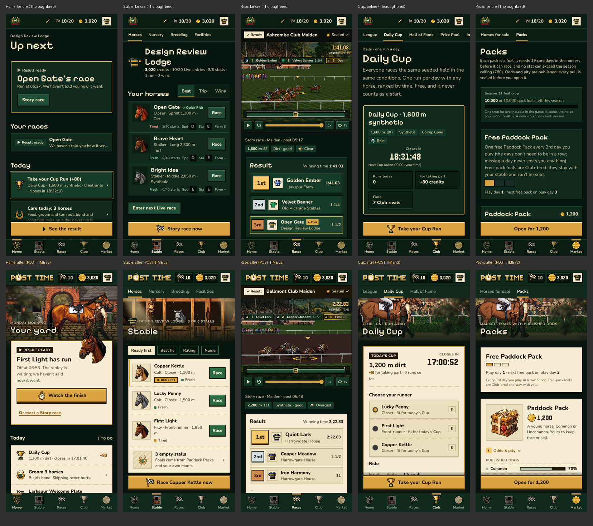
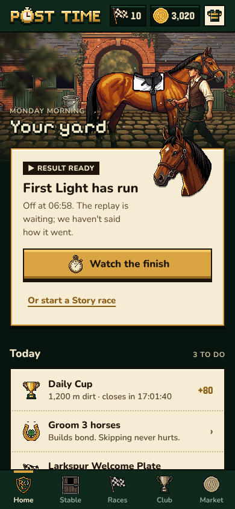
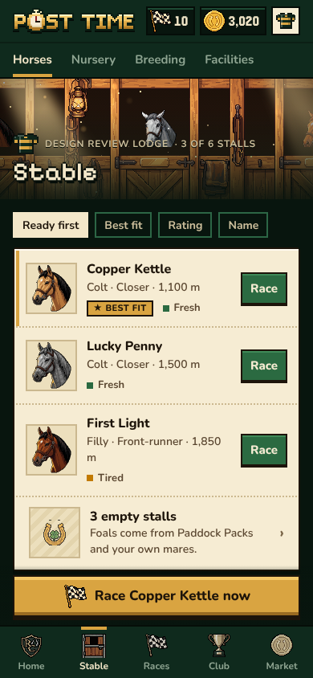
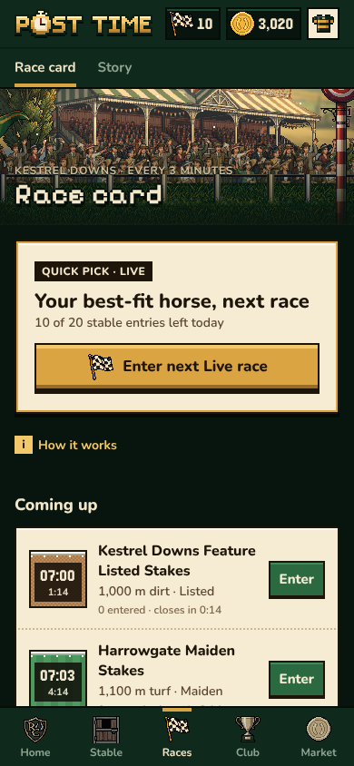
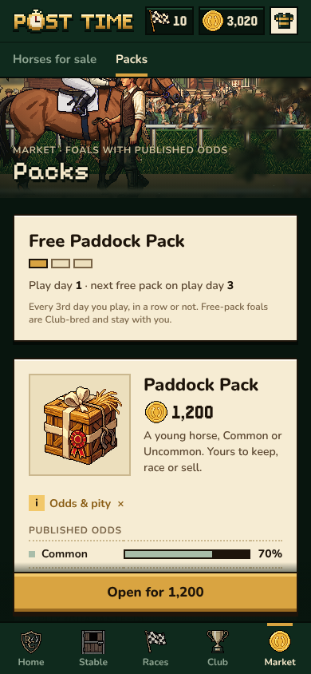

# POST TIME: a racing stable game


**Post Time** (the scheduled moment a race starts) is a **live, multiplayer horse-racing stable
game** that runs in the browser. Your home racecourse is **Kestrel Downs**, where a Live race
goes off every 3 minutes. You breed, raise,
train and manage horses that race live against other players' horses on a shared race card.
Alongside that there's a single-player **Story mode** against named AI rival stables. The
races are shown as an **HD-2D broadcast**: pixel-art horses in a real 3D racecourse.

> Breed it like Photo Finish, manage it like Football Manager, raise it like a ranch sim,
> ride it like Rival Stars. Simple on the surface, deep underneath. It never punishes you
> for being away.

**Brand:** the game was called "Thoroughbred" during development; the user-facing name is
now **Post Time** (internal package names stay `@thoroughbred/*`). Wordmark, icons and the
Design System v2 ("racecard at golden hour") are described in
[`docs/brand-and-design-v2.md`](docs/brand-and-design-v2.md); the brand files are in
`apps/web/public/brand/` (generator: `apps/web/scripts/brand/wordmark.py`).

**Status:** Phase 1 (core feel) is in progress. See [`docs/roadmap.md`](docs/roadmap.md) and
[`docs/HANDOFF.md`](docs/HANDOFF.md).
**Live preview** (latest work):
https://ranch-game-git-claude-thoroughbred-demo-meowdotfun.vercel.app

---

## Screenshots

Design System v2 at 390×844 (phone). Before and after, Home and Stable:



| Home | Stable | Race card | Packs |
|---|---|---|---|
|  |  |  |  |

---

## How the game works

| Area | How it works |
|---|---|
| **Races** | **Live:** a shared card with a race every 3 minutes. Entries close 1 minute before the off, AI horses fill empty gates, and the race is broadcast live with no spoilers. **Story:** solo races against AI rivals, which you can skip to the result. **Quick Pick** enters your best-fit horse in one tap. |
| **Fairness** | Races are simulated deterministically on the server from a committed seed. Anyone can verify the seed commitment and result hash. The outcome is never sent to clients before the finish is broadcast. |
| **Horses** | Every horse has a public **registration number** (`G<generation>-<sequence>`, e.g. `G2-04571`) and a **unique name** among active horses (2–18 characters; Hall of Fame names are retired for good). Genetics: a two-allele genome, a vigour gene, real coat-colour genetics, markings, breeds and body shape. Every horse's look is generated in code from its genes. Potential is revealed over time. |
| **Career clock** | Horses age by **career starts, not calendar time**: 40 starts, running juvenile → prime → veteran → retirement → stud → Legacy Farm. Freshness recovers in real time, with at most 3 starts per day. Injuries are visible before entry and never fatal. |
| **Breeding** | 4 breedings per horse, kinship blocks, inbreeding penalties, and a breeding preview with odds. Foals grow only through daily **care sessions**. Missing a day pauses growth and never harms the foal. |
| **Economy** | **In-game Stable Credits only. Never cashed out, and no prize money.** Credits come from purses, daily goals and capped Story rewards. They're spent on training, entries, breeding, packs, facilities and a credits-only market with a 5% fee that's burned. |
| **Limits** | **Stable entries:** +10 per day at local midnight, rolling over up to a bank of 20, with one credit refill per day. **Stall cap:** 6 stalls, up to 24 with upgrades. **Packs** give foals, with published odds and pity. Starter horses are bound to the account. Anti-multi-account rules apply. |
| **Retention** | Daily Cup, weekly leagues of 30, seasons and the Season Final, rivalries, Hall of Fame. All ethical: no streak shaming, no punishment for absence. |
| **Web3 (optional, later)** | Robinhood Chain (EVM): on-chain fairness proofs and a premium store paid in USDC. **Off by default.** The game works fully without a chain. |

All the decisions are in [`docs/game-design.md`](docs/game-design.md). Sections 4a–4f are
final user decisions; §12 lists deviations made during implementation.

---

## Screens and routes

Mobile has a five-tab bottom bar (Home · Stable · Races · Club · Market) and desktop has the
same five in the top bar. Each area's index screens share a one-row sub-nav, and detail
screens are the second and last level. The top bar holds the POST TIME wordmark, the entry
bank, the purse and your silks (→ `/me`, where **Feedback** lives; `/beta` has a floating
"?").

| Area | Routes |
|---|---|
| Home | `/`: the hero action (your race live or a result ready, otherwise Quick Pick), your races, **Today** tiles (Daily Cup, gift foal, care, free pack, mare ready to foal, next Story race) from `GET /api/home`, your horses, Live card |
| Stable | `/stable` (roster) · `/horse/:id` (+ `/care`, `/training`, `/career`; actions: plan a cover, stand at stud, sell) · `/nursery` · `/breeding` (`#studs` = stud book, incl. Club house stallions) · `/facilities` |
| Races | `/races` (Live card + Story) · `/race/:id` (broadcast, results, verify) · `/story` (chapters, rivals, licences) |
| Club | `/league` (`/club` redirects here) · `/cup` (+ `/cup/run/:id`) · `/hall` · `/pool`, `/invite` and `/beta` (beta & wallet: linked from Profile, not the core nav) |
| Market | `/market` (`#buy`, `#sell`, `#mine`) · `/packs` (+ `/packs/pulls/:id` proof) |
| Other | `/play` (found a stable; invite gate in playtest mode) · `/me` · `/admin` (playtest admin, `ADMIN_SECRET`) · `/dev/viewer`, `/dev/rig` |

**Closed playtest:** with `PLAYTEST_MODE=1`, founding a stable needs an invite code. Codes are
generated in `/admin`, and an invite link is `/play?invite=CODE`. Feedback, first-party
telemetry and tester records live in our own database. `/admin` covers metrics (day-1 and
day-7 retention, funnel, daily actives, races per day), invites, testers, the feedback inbox,
the manual payout ledger and the **reset** tool. The reset wipes game progress and keeps
testers, wallets, invite codes, feedback, telemetry and rewards. The env vars are listed in
`apps/web/.env.example`.

## Repository map

```
apps/web                Next.js 15 app (pages + /api route handlers), deployed on Vercel
packages/shared         Contract: shared types and zod schemas (race input/replay, live broadcast)
packages/racing-engine  Deterministic integer race simulation, seed commitments, verification
packages/race-viewer    HD-2D race broadcast (Three.js): camera, HUD, live-feed mode
packages/pixel-rig      Code-driven pixel horse rig: parts, skeletal gait, lighting, genetic looks
packages/art-pipeline   Asset manifest schema, coat palettes, PixelLab adapter interfaces
packages/game-core      Pure game rules: genetics, career, breeding, packs, ledger, economy, seasons
packages/db             Postgres schema and services (Drizzle). PGlite locally, Neon in production
packages/contracts      Solidity (Hardhat + OpenZeppelin) for Robinhood Chain (optional, WIP)
apps/web/public/art     PixelLab-generated HD pixel art (see manifest.json, STATUS.md)
art-src                 Art generation scripts, prompts and raw sources (reproducible)
tools/balance           Balance simulations and reports
docs/                   Design, architecture, research, balance, roadmap, handoff
```

## Docs index

| Doc | What's in it |
|---|---|
| [`docs/HANDOFF.md`](docs/HANDOFF.md) | **Start here:** current state, what's in flight, next steps, rules for agents |
| [`docs/game-design.md`](docs/game-design.md) | Game systems, loops and the user's final decisions |
| [`docs/architecture.md`](docs/architecture.md) | System graphs, race fairness pipeline, module graph, Vercel runtime decisions |
| [`docs/roadmap.md`](docs/roadmap.md) | Phases 1–6, exit criteria, KPI targets |
| [`docs/design-research.md`](docs/design-research.md) | UI/UX research with sources, and the redesign spec |
| [`docs/art-direction.md`](docs/art-direction.md) | HD-2D and HD pixel standard, file contract, pixel-rig pipeline |
| [`docs/balance.md`](docs/balance.md) | Balance targets, before/after numbers, economy faucets and sinks |

## Quickstart

Requirements: Node 20+ (22 recommended) and pnpm 10.

```bash
pnpm install
pnpm dev              # http://localhost:3000. Uses embedded PGlite when DATABASE_URL is unset
pnpm -r test          # all package tests
pnpm -r typecheck
cd apps/web && npx next build
# browser e2e against a running server (Playwright from NODE_PATH):
BASE_URL=http://localhost:3000 NODE_PATH=/opt/node-tools/node_modules node apps/web/e2e/smoke.mjs
# also: e2e/economy.mjs, e2e/horse-life.mjs, e2e/competition.mjs, and e2e/playtest.mjs (needs a
# server with PLAYTEST_MODE=1 ADMIN_SECRET=...; it resets that server's local database)
```

- **Environment:** see `apps/web/.env.example`. Vercel provides `DATABASE_URL` from Neon; set
  `CRON_SECRET` for the Live-card cron backstop (`/api/cron/race-card`, see `apps/web/vercel.json`).
  The web3 variables are off by default. The local dev database lives in
  `apps/web/node_modules/.cache/thoroughbred-pglite` (delete it to start fresh).
- **Dev pages:**
  - `/dev/viewer`: the race viewer harness. Query params: `horses`, `t`, `camera`,
    `weather`, `live`.
  - `/dev/rig`: the pixel-rig studio.
  - `?rig=1` on any race page tries the experimental pixel rig.

## Engineering rules

1. **Determinism:** the race engine uses integer maths only, with no `Date` and no
   `Math.random`. Any change to its output needs an `ENGINE_VERSION` bump and new golden
   test values.
2. **No spoilers:** live endpoints never reveal the result, seed or finish times before the
   finish is broadcast. Leak tests enforce this.
3. **The server is authoritative:** clients send choices (horse, plan), never outcomes.
   Every financial change is ledgered (double-entry, idempotent).
4. **Pixel integrity:** nearest filtering and integer scales. Pixel fonts are for titles
   and big numbers only.
5. **Ethics:** no cash-out, no gambling mechanics, no punishing absence, published odds.
6. **Secrets:** never commit keys. The PixelLab key lives outside the repo; Neon and Vercel
   secrets are managed by Vercel.

## Deploy

- **Vercel project:** `ranch-game` (team `meowdotfun`), root directory `apps/web`.
- **Branches:** every branch gets a preview deploy. `main` is production and only receives
  tested milestones.
- **Database:** Neon Postgres, connected for Preview and Production. Migrations are
  additive only, because preview and production share one database.
