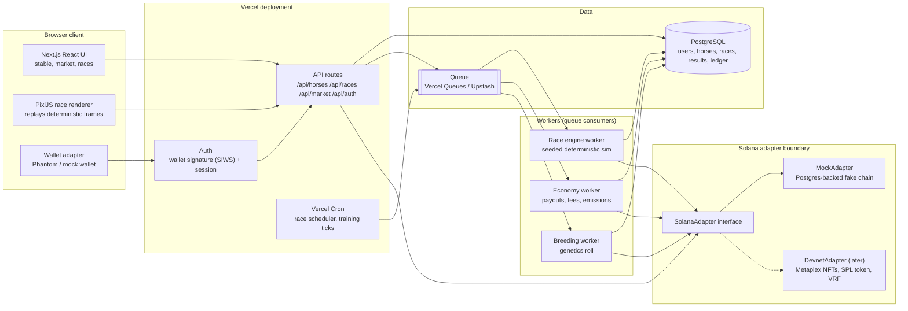
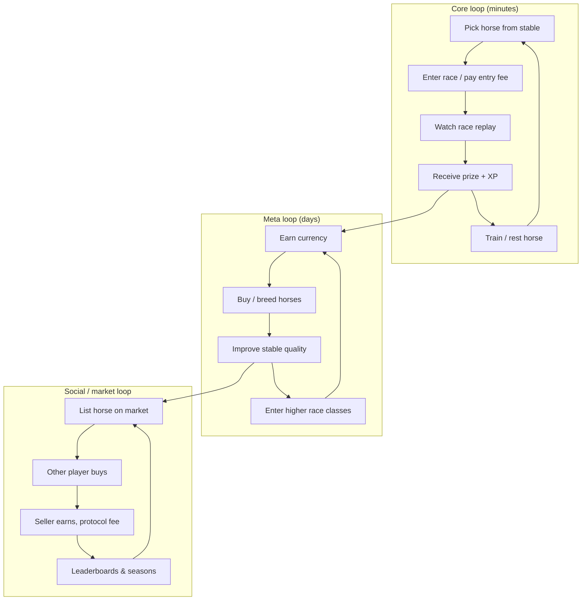
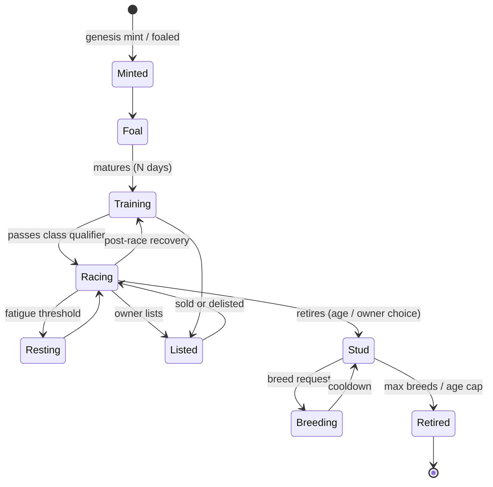
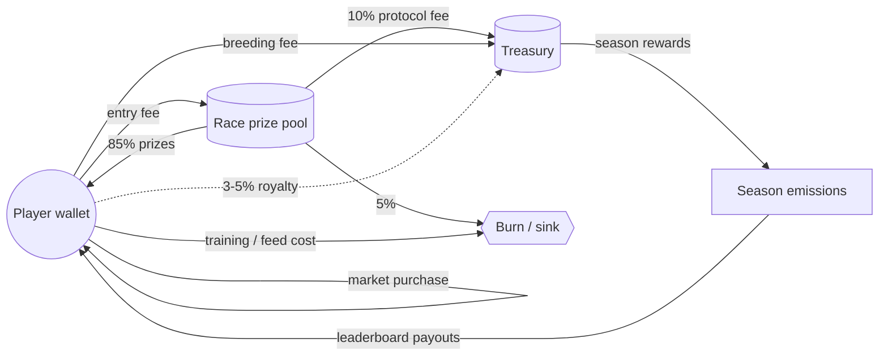
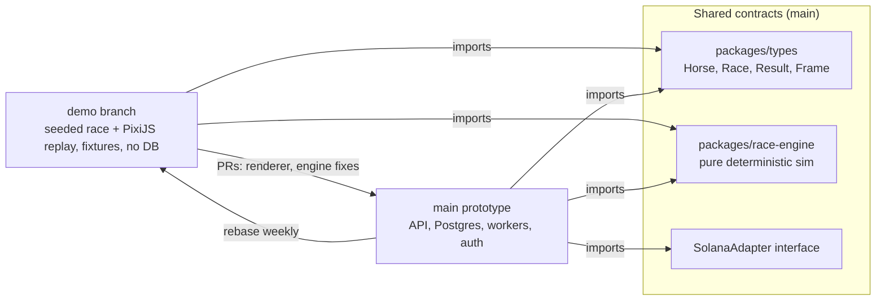

# PROJECT THOROUGHBRED — Architecture (MVP)

Target: Vercel (Next.js App Router + API routes / Route Handlers), external Postgres (Neon/Supabase), background workers via Vercel Cron + a queue, Solana behind an adapter interface (mock first, devnet later).

## 1. System architecture & service boundaries



Boundaries: the client never computes outcomes, only replays them. API routes are thin (validate, write intent, enqueue). Workers own all state transitions. Everything chain-related goes through `SolanaAdapter`, so swapping mock for devnet changes no game code.

## 2. Product loops



## 3. Horse lifecycle



## 4. Race engine fairness sequence

Commit-reveal so neither the server nor players can steer results after entries close.

```mermaid
sequenceDiagram
  autonumber
  participant P as Player
  participant API as API route
  participant DB as Postgres
  participant S as Scheduler (Cron)
  participant W as Race worker
  participant SA as SolanaAdapter
  participant C as Client (PixiJS)

  S->>DB: create race (open)
  S->>DB: store commit = hash(serverSeed)
  Note over DB: commit hash is public before entries
  P->>API: enter race (horseId, signed)
  API->>DB: validate eligibility, lock horse, debit fee
  S->>DB: close entries at T, freeze field
  S->>W: enqueue run(raceId)
  W->>SA: fetch entropy (mock: slot hash stub / later: VRF or slot hash)
  W->>W: seed = hash(serverSeed ‖ chainEntropy ‖ raceId ‖ sorted entries)
  W->>W: deterministic sim (fixed timestep, seeded PRNG)
  W->>DB: write results + frame log + reveal serverSeed
  W->>SA: settle (mock ledger / later on-chain record)
  C->>API: GET race replay
  API-->>C: frames + seed + commit
  C->>C: render; optional local re-sim to verify
```

## 5. Economy flows



Splits are placeholders to tune. In the MVP every arrow is a row in a double-entry `ledger` table via `MockAdapter`; nothing touches real funds.

## Quick demo branch, horizontal integration



1. Main owns the shared contracts: types, the pure race engine, and the adapter interface. These change only by PR to main.
2. The demo branch builds the visible slice (deterministic race + PixiJS replay) against fixtures, with no database or wallet.
3. Engine and renderer improvements from the demo merge back to main as small PRs; main gets rebased into demo regularly.
4. Integration point: once main's `/api/races/:id/replay` returns the same `Frame[]` shape, the demo renderer is dropped into the real app unchanged.
5. CI on both runs the same golden-seed test (same seed and entries produce identical results) so they can't drift.
