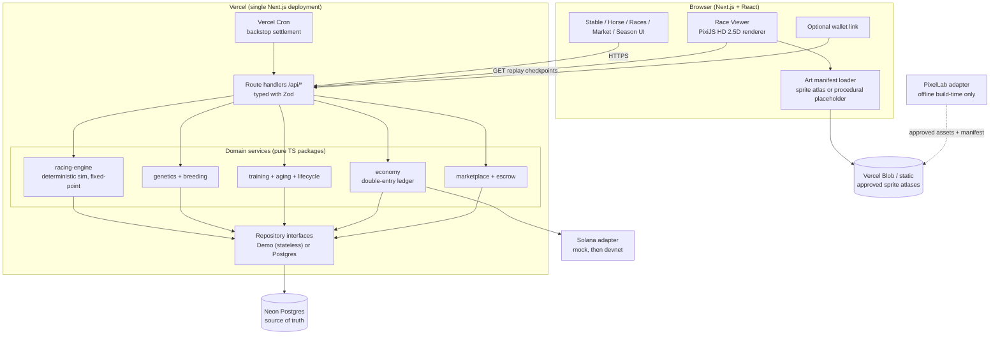
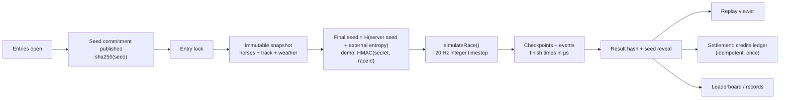
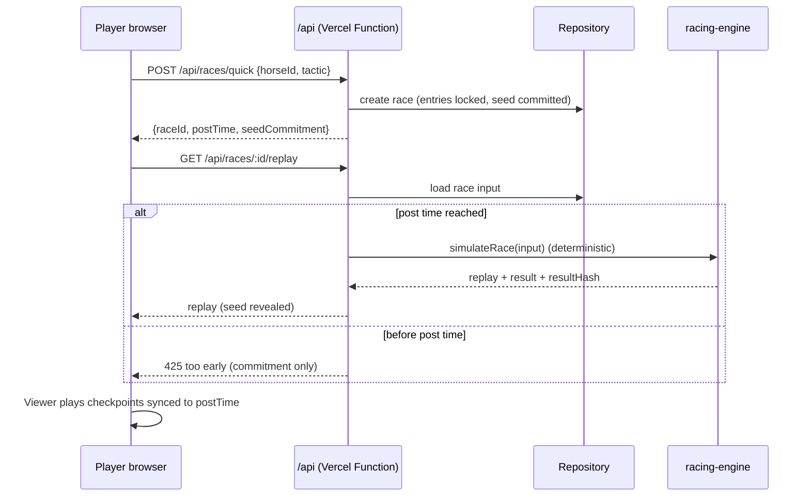
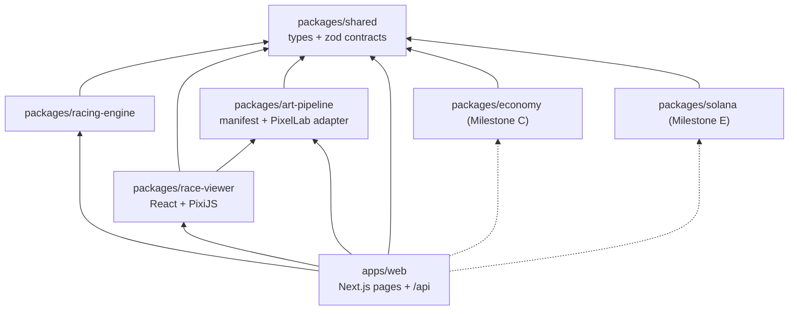
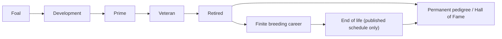
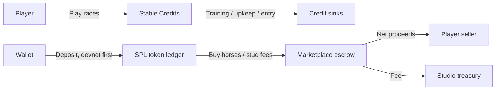
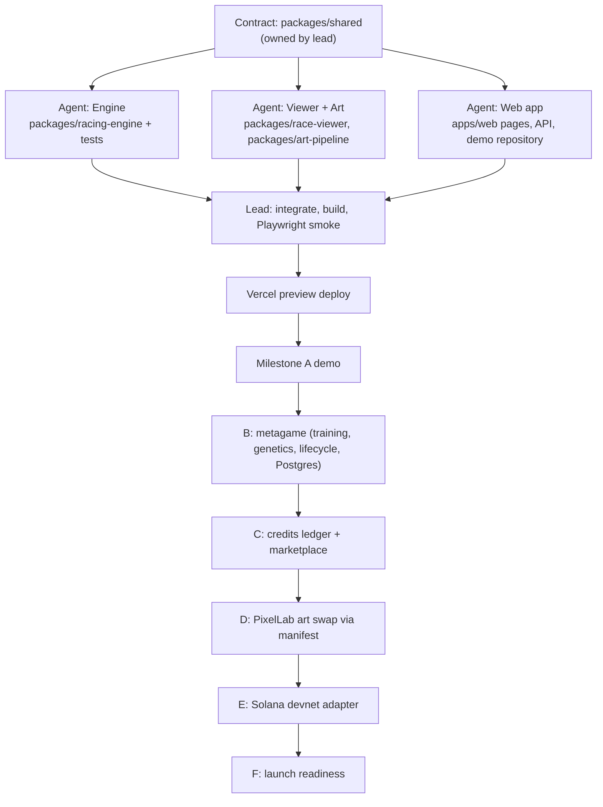

# Project Thoroughbred: System Architecture

This is the map for the whole project. Every module, agent workstream and milestone
refers back to these graphs. Diagrams are Mermaid source.

## 1. Whole system

## 2. Race fairness pipeline

The server runs a race once, at post time. Everyone then plays the same stored
checkpoints, in sync with the post-time clock. Live races need no WebSockets.

## 3. Race request sequence

## 4. Module dependency graph (monorepo)

The arrows are imports. The domain packages never import from apps.

## 5. Horse lifecycle

## 6. Economy

## 7. Delivery pipeline and agent workstreams

## 8. Integration contract with other branches

Other branches (for example a parallel prototype) can adopt pieces one at a time,
because each module only talks through `packages/shared`:

| Want | Import | Contract |
|---|---|---|
| Deterministic races | `@thoroughbred/racing-engine` | `simulateRace(RaceInput): RaceReplay` |
| Race visuals | `@thoroughbred/race-viewer` | `<RaceViewer replay startAtMs? />` |
| Art slots | `@thoroughbred/art-pipeline` | `AssetManifest`, `PixelLabAdapter` |
| Types / validation | `@thoroughbred/shared` | Zod schemas + TS types |

Persistence is behind `RaceRepository` / `HorseRepository` in `apps/web/src/server`.
The stateless demo repository can be replaced with Postgres without changing pages.

## 9. Vercel runtime decisions

- **One deployment.** Next.js pages and `/api` route handlers. There's no separate API server.
- **Races are computed on request, at or after post time.** A race takes milliseconds to
  simulate and is idempotent, so the result can be cached forever once revealed.
- **Settlement happens on request, with cron as a backstop.** The first read after post
  time settles the race exactly once, using an idempotency key. A cron sweep covers races
  nobody looks at.
- **Live viewing is synchronized playback** of stored checkpoints against `postTimeMs`.
- **PixelLab runs at build time only.** It never runs per request or per frame.
