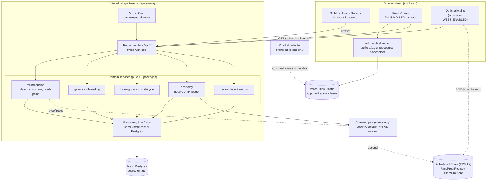
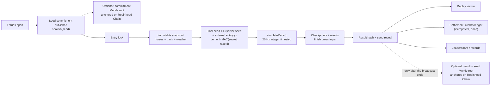
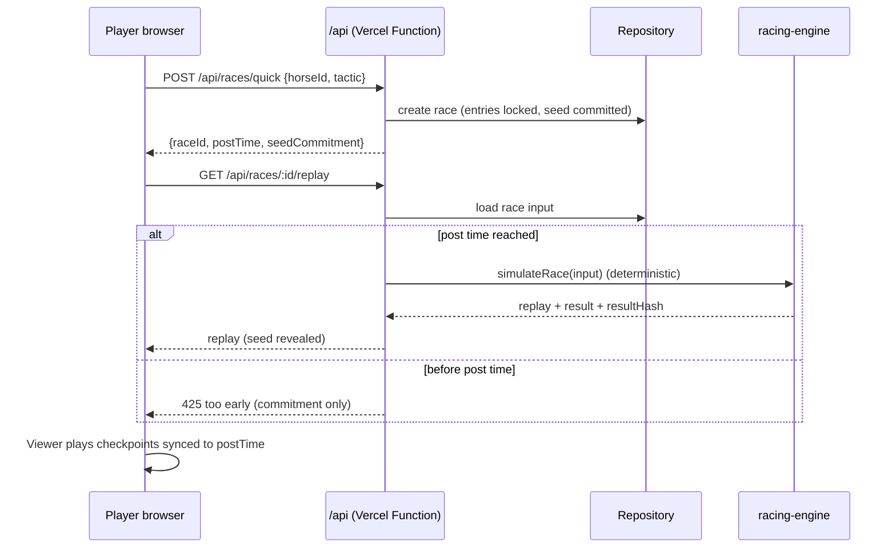
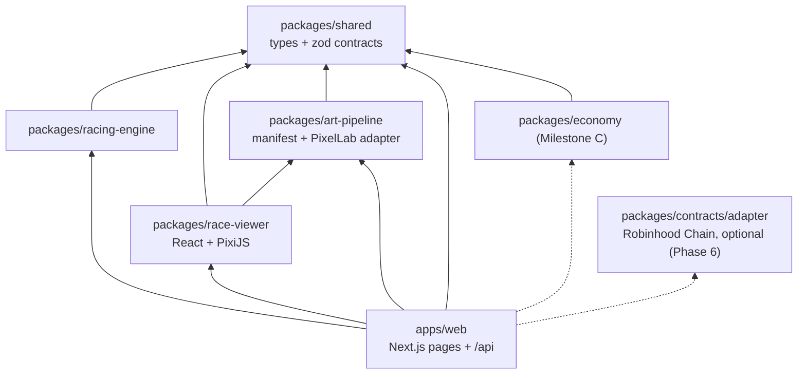
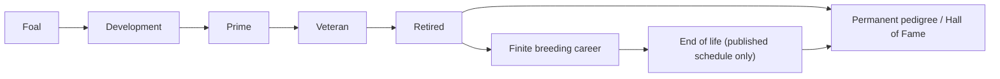
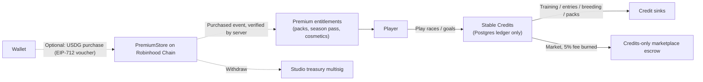
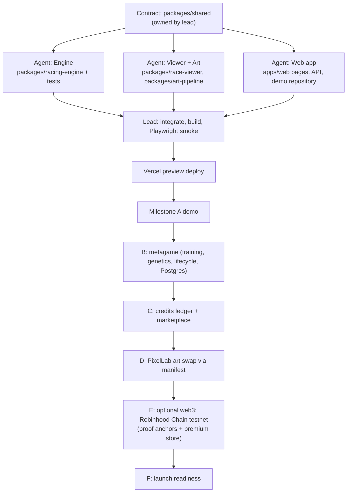

# Project Thoroughbred: System Architecture

This is the map for the whole project. Every module, agent workstream and milestone
refers back to these graphs. Diagrams are Mermaid source.

## 1. Whole system

## 2. Race fairness pipeline

The server runs a race once, at post time. Everyone then plays the same stored
checkpoints, in sync with the post-time clock. Live races need no WebSockets.

## 3. Race request sequence

## 4. Module dependency graph (monorepo)

The arrows are imports. The domain packages never import from apps.

## 5. Horse lifecycle

## 6. Economy

Stable Credits live only in the Postgres double-entry ledger. They are **never on-chain and
never cashed out**. The optional web3 layer (`docs/web3.md`) is a one-way checkout for
premium entitlements, plus public fairness anchors.

## 7. Delivery pipeline and agent workstreams

## 8. Integration contract with other branches

Other branches (for example a parallel prototype) can adopt pieces one at a time,
because each module only talks through `packages/shared`:

| Want | Import | Contract |
|---|---|---|
| Deterministic races | `@thoroughbred/racing-engine` | `simulateRace(RaceInput): RaceReplay` |
| Race visuals | `@thoroughbred/race-viewer` | `<RaceViewer replay startAtMs? />` |
| Art slots | `@thoroughbred/art-pipeline` | `AssetManifest`, `PixelLabAdapter` |
| Types / validation | `@thoroughbred/shared` | Zod schemas + TS types |
| Optional chain (server only) | `@thoroughbred/contracts/adapter` | `createChainAdapter()`: `verifyPurchase`, `publishProofBatch`, `getBalances` (Mock unless `WEB3_ENABLED=true`) |

Persistence is behind `RaceRepository` / `HorseRepository` in `apps/web/src/server`.
The stateless demo repository can be replaced with Postgres without changing pages.

## 9. Vercel runtime decisions

- **One deployment.** Next.js pages and `/api` route handlers. There's no separate API server.
- **Races are computed on request, at or after post time.** A race takes milliseconds to
  simulate and is idempotent, so the result can be cached forever once revealed.
- **Settlement happens on request, with cron as a backstop.** The first read after post
  time settles the race exactly once, using an idempotency key. A cron sweep covers races
  nobody looks at.
- **Live viewing is synchronized playback** of stored checkpoints against `postTimeMs`.
- **PixelLab runs at build time only.** It never runs per request or per frame.

## 10. Optional web3: Robinhood Chain (EVM)

The chain is Robinhood Chain, an Arbitrum-based L2: mainnet 4663, testnet 46630. **It's off by
default** (`WEB3_ENABLED` unset), and the game never needs it. The full design, threat model
and rollout gates are in `docs/web3.md`.

- **What's on-chain:**
  - `RaceProofRegistry`: write-once Merkle roots of seed commitments (at entry open) and
    of results plus revealed seeds (after the broadcast ends). Anyone can verify with
    `verifyRace`.
  - `PremiumStore`: one-way USDG checkout using server-signed EIP-712 vouchers and
    single-use order ids.
- **What isn't on-chain:** Stable Credits, horses, the market, the ledger. Postgres stays
  the source of truth.
- **Server adapter:** `packages/contracts/adapter`. `MockChainAdapter` (default) and
  `EvmChainAdapter` (viem) share one `ChainAdapter` interface. Keys come from Vercel env
  and are never sent to the client.

## 11. Accounts (anonymous device sessions)

There are no emails or passwords. An account is a device: the browser holds a random 256-bit
token in the httpOnly `tb_session` cookie, and only its sha256 (`accounts.token_hash`) is
stored. `authenticate()` resolves the token to the account (and its stable) on every request.

**Device linking** (`packages/db` `services/devices.ts`, routes under `/api/account/*`): to
play the same stable on another device, the signed-in browser gets a one-time code
(`POST /api/account/link-code`) — 8 characters from an unambiguous alphabet (no 0/O/1/I/L),
shown as `XXXX-XXXX`, valid 10 minutes, single use; a new code expires the account's previous
unused ones. Codes are stored hashed (`link_codes.code_hash`). The other device redeems it at
`POST /api/account/link` (works signed out): the redemption is one transaction that marks the
code used only while still fresh (`used_at is null`), so two devices can never share one code,
and it inserts a per-device token into `account_devices` and sets the session cookie. Every
failure answers the same generic "That code didn't work"; failed redemptions are rate-limited
per IP (20/hour → 429); a browser that already has a stable in play must confirm
`{ replace: true }`. Successful links are recorded as an identity signal (kind "device"), so
anti-multi-account sees one person. `GET/DELETE /api/account/devices` list and revoke linked
devices; the founding browser's token is not a device and can't be revoked from there.

**Wallet sign-in** (`apps/web` `src/server/walletAuth.ts`, routes under `/api/auth/wallet/*`,
detailed in `docs/web3.md` §3.4): a wallet can bring the stable to any device with one free
SIWE signature — no code, no transaction. The login wallet is `accounts.wallet_address`
(unique): every successful SIWE verification sets it when unset, and lookups fall back to a
verified tester row. `POST /api/auth/wallet/challenge` stores a one-time 10-minute
login-purpose message (no account bound; `wallet_challenges.purpose` keeps it separate from
payout-link challenges); `POST /api/auth/wallet/verify` checks the signature against the
address in the stored message, consumes the nonce, and either signs the wallet's stable in
(an `account_devices` row, with the same `{ replace: true }` guard), links an unknown wallet
to the browser's stable, or answers `{ needsStable }` — `{ create: true }` founds the stable
and links the wallet in one request. Challenge + verify are rate-limited per IP (30/hour →
429). WalletConnect (optional env, loaded on click) covers phone wallets; injected EIP-6963
wallets always work. Web3 stays optional — the code-link flow above is unchanged.
