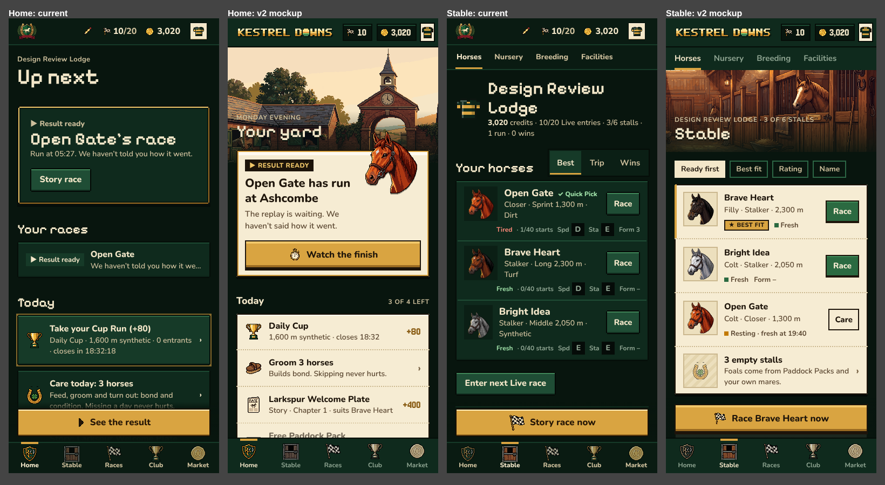
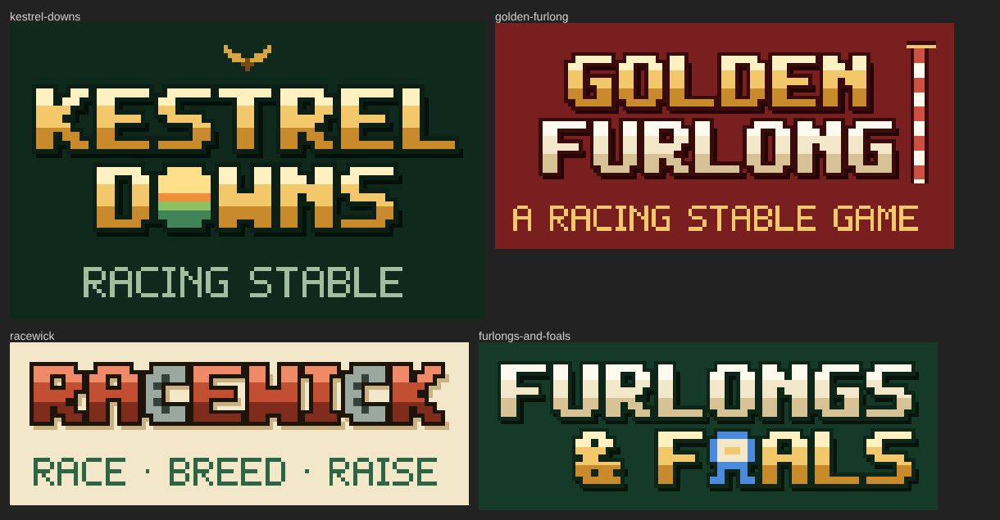
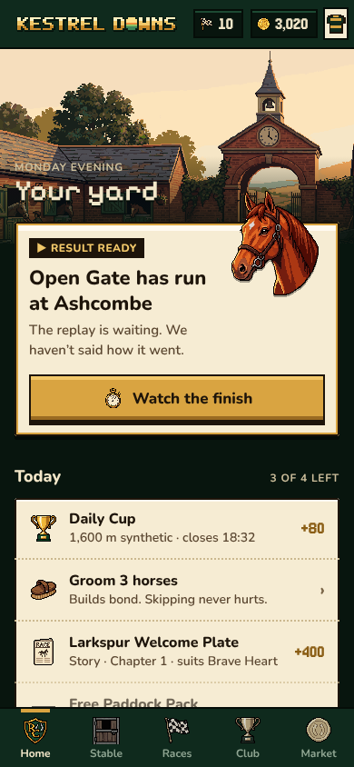
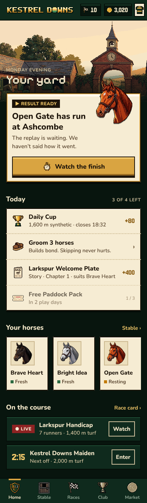
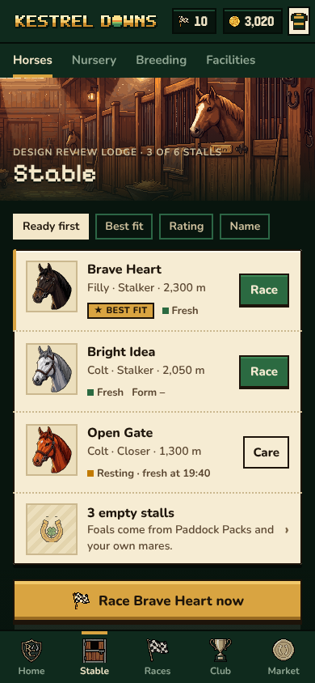
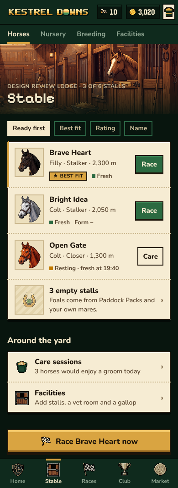

# Brand & Design v2: from "dark dashboard" to "racecard at golden hour"

> **Decision (user, 2026-10-26):** the game is named **POST TIME** (the scheduled moment a race
> starts). **Kestrel Downs** stays as the home racecourse in the game world. The design system
> below is implemented in `apps/web` (see `docs/HANDOFF.md`, "POST TIME rebrand + Design System
> v2"); the wordmark's emblem is a brass race stopwatch in the O.

> Status: creative direction for the next implementation pass. Research, brand and design only;
> no app code was changed. Date: 2026-10-26.
> Builds on [`design-research.md`](design-research.md) (UX research, IA, race broadcast, ethics) and
> [`art-direction.md`](art-direction.md) (HD pixel standard). Where this doc says **supersedes**, it
> replaces the named rule; everything else in those docs still stands.
>
> Assets: mockups and wordmark sketches are in [`docs/brand-v2/`](brand-v2/). The working files
> (HTML mockups, generator scripts and all screenshots of the current build) are in the session
> scratchpad under `brand/`; see §9.



---

## 0. TL;DR

1. **The game already owns gorgeous art and hides it.** The PixelLab scenes (stable yard, barn,
   paddock, grandstand) are warm, golden-hour, brick-and-honey. The signed-in app is
   dark-green-on-dark-green boxes. Every successful indie site we studied leads with its art and
   takes its UI palette from it. v2 puts a scene band at the top of every area and takes the palette
   from the scenes.
2. **Two materials, not one.** *Baize* (deep green) for chrome, nav and the race stage. *Racecard
   paper* (cream, ink keyline) for everything you read: rows, cards, results. Today everything is
   the same green panel, so nothing has hierarchy.
3. **One pixel display line per screen.** Pixel type only for the page title and big numerals.
   Section heads move to Nunito 800. Today pixel type appears at five or more sizes per page, which
   is a big part of why it reads as "sloppy".
4. **One brass thing per viewport.** The hero, or the sticky action. Not frames, tabs, tiles and
   borders.
5. **Shorter, warmer copy.** Every page opens with a rules paragraph. Move rules into "How it
   works" sheets. Lead with what's happening to *your* horses.
6. **Brand:** rename to **Kestrel Downs** (recommended). Shortlist: Kestrel Downs · Golden Furlong
   · Racewick · Furlongs & Foals. "Thoroughbred" is a dictionary and breed word. It can't be
   owned, searched or trademarked in any useful way.

---

## 1. Why the current UI feels sloppy (honest critique)

Screenshots were taken from the preview deploy on 2026-10-26 at 390×844 and 1440×900, signed in as a
fresh stable ("Design Review Lodge"). Files are `brand/current/{m,d}-<page>-{fold,full}.png` in the
scratchpad. Pages: home, stable, races, race, story, cup, league, breeding, packs, market, plus mobile
horse, hall, me, invite, beta, nursery, facilities, pool and signed-out home and play. Note: in
full-page captures the fixed tab bar and action bar appear mid-page. That's a capture artefact, not a
bug.

### The top 10

| # | Problem | Where you see it | Why it reads as sloppy |
|---|---|---|---|
| 1 | **Monotone surfaces: green box on green page, everywhere.** Page `#08150e`, panels `#0f2a1d`, raised `#163a28` and hairlines `#1f4d35` sit within about 1.3:1 of each other. | Every page; most visible on `m-cup-full`, `m-breeding-full`, `m-league-full` | No figure and ground. The eye can't tell a card from a page from a well, so the page feels like one undifferentiated dashboard. Nested boxes (Cup: frame, then stat tiles, then inner panels; Breeding: three levels) look like a wireframe. |
| 2 | **The world is missing.** The beautiful scene art appears only on the signed-out landing (`m-home-signedout`) and onboarding (`m-play-signedout-full`). Once you're signed in it's gone. | All signed-in pages | Players can't tell they're in a game. Stardew, Eastward, Dredge, Sea of Stars and Unpacking all put their art first (§2). |
| 3 | **Typographic noise.** Pixelify Sans is used at about six sizes on one page: H1 about 40, hero title about 30, section heads about 22 ("Your races", "Today"), card titles about 20 ("Daily Cup · 1,600 m synthetic" wraps to two lines), plus Jersey numerals and Nunito at four weights. Pixel faces at in-between sizes look blurry and uneven. | `m-home-full`, `m-cup-full`, `m-packs-full` | No clear hierarchy, and pixel type below about 32 px looks accidental rather than designed. |
| 4 | **Rules-first copy.** Every index page opens with a 2–4 line rules paragraph ("A race every 3 minutes, live for everyone at once. Enter your horses until a minute before the off; the Club fills empty gates."). Rows chain 5–7 facts with mid-dots: "2,000 m · Turf, good · Maiden · 0 entered · closes in 1:08 · 1 entry". | `m-races-fold`, `m-league-full`, `m-packs-full`, `m-story-full` | It reads like a manual. It pushes content below the fold, and long rows truncate ("Kestrel Downs Mai…", "Larkspur Listed St…"). |
| 5 | **Competing primary actions and mismatched labels.** Home has a hero button "Story race" *and* a sticky "See the result" for the same thing. Stable has a sticky "Story race now" plus a green "Enter next Live race" plus three "Race" buttons. Breeding's sticky bar is a full-width disabled brass "Can't cover yet". | `m-home-fold`, `m-stable-full`, `m-breeding-full` | Two labels for one action looks like a bug. A disabled primary bar shouts about something you *can't* do. |
| 6 | **Brass is still everywhere.** It's on hero frames, the Cup tile border, tab underlines, selected-tab fills, "Picked" chips, sticky bars, LED numerals and stat tiles. | `m-cup-full` (brass hero frame + brass CTA + brass tiles), `m-breeding-full` (two brass "Picked" frames + brass bar) | Brass no longer means "act here". Several things on one screen compete to be the focal point. |
| 7 | **Three different tab components.** Underlined sub-nav (Horses / Nursery…), boxed segmented tabs (Best / Trip / Wins; Buy / Sell; Barn / Stud book), and story chapter tabs. The Club sub-nav also overflows ("In…" cut off) with no scroll cue. | `m-stable-full`, `m-market-full`, `m-breeding-full`, `m-league-full` | Inconsistent components are the most common "unpolished" signal. |
| 8 | **Mixed pixel densities and icon styles.** 32 px PixelLab icons (nav), about 12 px glyphs (flag, weather), a 128 px portrait shown at about 60–200 px, a silks avatar in a cream box, and a crest that turns to mush at 32 px. Market's coin icon is a different visual weight from the other nav icons. | Top bar, tab bar, `m-horse-full`, `m-races-fold` (weather glyphs) | Mixels are the classic tell of unfinished pixel UI (see design-research §5.1). |
| 9 | **Empty states are dead ends.** "No horses for sale right now… check back later" above an empty void (`m-market-full`), "No Live results this season yet", "Your pulls… will appear here", and 20 identical locked achievements in the Hall. | `m-market-full`, `m-league-full`, `m-packs-full`, `m-hall-full` | There's no illustration, no next step and no personality. Empty states are where polish shows most. |
| 10 | **No logo, no brand.** "Thoroughbred" is set in the same Pixelify as every heading. The crest at 32 px is illegible, and on mobile there's no name at all. | Top bar (`m-*-fold`, `d-*-fold`) | Every reference game has a crafted wordmark that carries the identity (§2.1). Ours is a font choice. |

### Also worth fixing

- **Vertical rhythm is irregular.** Section gaps run 24–64 px at random. Some tiles clip their own
  text ("condition. Missing a day never hurts." is cut by the card edge on `m-home-full`).
  Desktop "Live races" and "Recent results" headings sit at different baselines (`d-home-full`).
- **Desktop is a stretched phone.** There are 3 horse cards in a 4-column row with an empty slot,
  and full-width single rows (`d-home-full`). The hero portrait sits on a flat green square.
- **Grade chips are black squares** ("D", "E") with no ramp and no label (`m-stable-full`). They
  carry little meaning on a list.
- **Crypto is front-loaded on `/me`.** "Wallet, Prize Pool & invites → Connect wallet" is the
  *first* card on the profile page. The `/invite` copy explains "commission in ETH… 10%…
  3%… Two levels, no more" in a dense bulleted wall. That reads like a referral scheme, not a
  cozy game. It's a brand and trust risk, and it breaks design-research principle 17 ("wallet
  stays invisible until wanted"). Keep the feature, but move it, collapse it and rewrite it (§7.3).
- **"Start over with a new stable"** is a filled red button in the middle of settings.
  Destructive actions belong behind a confirm, styled as a text button.
- **The race page is the strongest screen** (`m-race-fold`, `d-race-fold`): real scene,
  scoreboard numerals, chiclets, broadcast grammar. But its control row adds a 4th type style
  (monospace caps "DIRECTOR / MY HORSE"), and the result sits in nested green boxes.

---

## 2. Research: how successful indie games look premium

Method: live captures of 19 official sites at 1440×900 (scratchpad `brand/refs/*.png`, with the
fonts and body background read from computed styles), plus published interviews, store pages and
design analyses. In-game observations from playing the games are marked *(observed)*. Davethediver's
official page returned 404 and cultofthelamb.com showed a bot check, so they're covered from
knowledge and secondary sources.

### 2.1 Patterns, with evidence

| Pattern | Evidence | What we take |
|---|---|---|
| **The wordmark is an illustrated object, with one emblem of the game built into a letter.** | Balatro's A is a playing card; Unpacking's logo has a cardboard box; Celeste's letters are snow-capped; Stardew's are carved gold with leaves; Hades II has a carved Roman II; Neal.fun puts a pumpkin in the dot; Loop Hero is pixel lettering in a pixel frame (live captures). | A pixel-lettered wordmark with a racing emblem (sun over the downs, horseshoe, rosette, furlong pole) in a letter. See §3. |
| **Art first, full-bleed, at the top. The palette comes from the art.** | Stardew (sky-blue pixel valley), Sea of Stars, Eastward (yellow paper with a sketchy illustration), Dredge (sepia lighthouse key art), Hades II (key-art band), Slay the Spire (painted band, then a cream section) (live captures). | A scene band per area (Home = stable yard, Stable = barn, Races = grandstand, Club = paddock), with UI colours sampled from the scenes. |
| **Warm, light content surfaces are common, even for dark games.** | Hades II's page is `#f2efec` off-white; Slay the Spire uses a cream `#f2f0c4` band; Unpacking is peach `#e9ccb6`; Eastward is warm yellow paper; Neal.fun is white with each tile a mini poster (computed backgrounds). | A cream "racecard paper" material for content. Dark baize stays for chrome and the stage. |
| **One characterful display face plus one plain text face.** | Balatro's site is set in **m6x11** (the same pixel font as the game); Hades II pairs `quatro-slab` with `proxima-nova`; Kingdom pairs `Pirata One` with `EB Garamond`; Sea of Stars pairs `neusa-next condensed` with `orpheuspro`; Stardew uses `Nunito`/`Open Sans` for text (computed fonts). | Keep Pixelify (display) + Jersey 10 (numerals) + Nunito (text), but with strict roles (§4.3). |
| **Colour is the label.** | Balatro: blue = chips, red = mult, gold = money, consistently ([Crosley breakdown](https://blakecrosley.com/guides/design/balatro), an analyst's reconstruction). | Brass = act or yours; oxblood = live; turf green = good; nothing decorative. |
| **Feedback is proportional to significance.** | Balatro: shake and sound scale with score; counters roll; Jokers fire left to right ([Crosley](https://blakecrosley.com/guides/design/balatro); [indieklem](https://indieklem.substack.com/p/20-a-look-at-100-interface-games): "Balatro is definitely the king of juice"). Counterpoint: juice must fit the game's tone ([GameAnalytics via search](https://gameanalytics.com/?p=3400)). | Big juice only for results, wins, foals and pack reveals. The chrome stays calm. |
| **Restraint signals quality.** | "Fewer colors in our palette isn't a bad thing" ([indieklem on *In Other Water*](https://indieklem.substack.com/p/20-a-look-at-100-interface-games)). Papers, Please turns the "validate" button into a stamp (same source). | A limited ramp per material. The verbs are physical: *Stamp*, *Saddle up*, *Pin the rosette*. |
| **Consistency at volume is the craft.** | Supergiant's Hades II UI-illustrator brief: "Create hundreds of icons in a stylistically consistent way", mock-ups "based on gameplay requirements", files "motion-graphics ready", plus "accessibility standards" ([Supergiant job post](https://www.supergiantgames.com/blog/job-opportunity-ui-illustrator-for-hades-ii)). | One icon grid, one outline rule, one light direction (§4.6). |
| **Management UIs: tile, then card, never deeper.** | FM26's principles are "Efficiency, Familiarity, and Predictability". Tiles "open up into a Card that carries more detail". The Portal merges Home and Inbox into "a one-stop shop" ([FM26 UI feature](https://www.footballmanager.com/features/total-football-total-control-fm26s-reimagined-user-interface)). Reviews flagged too many pop-ups ([GosuGamers](https://www.gosugamers.net/entertainment/news/77565-review-football-manager-26-looks-good-but-its-buggy-interface-leaves-much-to-be-desired)). | Home is a portal: hero, Today list, horses, live. Rows open sheets. No pop-ups on load. |
| **Show only the currencies that matter on each screen.** | Rival Stars 1.37: "the Currency Bar will now only display the relevant currencies for each screen" ([patch notes](https://www.rivalstarshorseracing.com/post/1-37-update)). | The top bar shows credits and entries; Market adds nothing; Packs shows the pack timer, not entries. |
| **Mobile-first vertical layouts for horse-raising.** | Umamusume's layout is "vertical… built for smartphones" and the race involves "minimal interaction" ([Multiplayer.it review](https://multiplayer.it/recensioni/umamusume-pretty-derby-recensione.html)). Its home is a character standing in a scene, with big rounded buttons in the thumb zone *(observed)*. | A portrait in the hero card breaking out of the frame; actions at the bottom. |
| **HD-2D: pixel world, crisp UI.** | Octopath and Sea of Stars use parchment or ink plates and clean text over pixel worlds *(observed)*. Dave the Diver mixes 2D pixels with 3D depth ([Game Developer](https://www.gamedeveloper.com/design/dave-the-diver)), and its in-game "phone" UI is flat, bright and app-like over pixel art *(observed)*. | Text never in pixel fonts below 32 px; paper and ink plates over scenes. |
| **Game-first web: the toy is the page.** | Neal.fun's homepage is a grid of illustrated tiles, each its own mini brand (live capture). Vampire Survivors' studio site is a plain, self-deprecating hand-made page ("We make allegedly fun games. For fun.") with a lime "Latest" feed (live capture). | Tiles with a small illustration beat generic rows for Today, Story chapters and Packs. Copy can be wry. |
| **Small studios look big through a press-kit discipline.** | Every site studied links to a press kit, wallpapers and merch: Hades II's media zip, Dredge's press kit and wallpapers, Balatro's press kit (live captures and [WebFetch summaries](https://www.supergiantgames.com/games/hades-ii/)). | Later: an `/about` press kit with logo files, scenes as wallpapers and an OG image per race. |

### 2.2 Naming research

- **Distinctive beats descriptive, up to a point.** A 5,820-game Steam analysis (Tuts+, summarised
  by [Wayline](https://www.wayline.io/blog/game-title-naming-strategies-indie-devs) and in search
  results) reports that successful titles used a unique or non-dictionary word far more often:
  48% vs 28%. Treat that as indicative; it's one dataset.
- **Signal the genre's "vibe", don't keyword-stuff.** Chris Zukowski: titles should hint at genre with
  "just enough of these secret shibboleths". Don't make a title "so unique that nobody knows what
  it is". Title length doesn't correlate with sales. Do the yell test at a convention: can someone
  spell it, and can they guess the genre? ([How To Market A Game](https://howtomarketagame.com/2025/02/03/are-game-names-getting-longer-how-to-quit-your-job-and-write-a-title-for-your-steam-game-in-2025-naming-seo-tips-faq-guide-profits-earnings-optimization/)).
- **Check stores and trademarks early** ([Wayline](https://www.wayline.io/blog/naming-your-video-game-strategies-legal-market-impact),
  [Bugnet](https://bugnet.io/blog/how-do-you-name-your-indie-game)).
- **Place names make worlds.** Stardew Valley, Animal Crossing and Two Point Hospital are named after
  the place, not the activity, so the brand becomes somewhere you return to *(observed)*. Racing is
  full of place names: Epsom Downs, Churchill Downs, Emerald Downs, Ascot. Our world already has
  them: Larkspur, Harrowgate, Ashcombe, Bellmont, Saltmarsh, and **Kestrel Downs**, already a live
  racecourse on the card.
- **Horse-racing names already taken or crowded:** *Photo Finish*, *Rival Stars*, *Winning Post*
  (Koei), *Derby Stallion*, *Final Furlong* (Namco arcade), *Fantasy Furlong* (a betting manager
  app: [App Store](https://apps.apple.com/app/id1093106724)), *Starters Orders*, *Pocket Horse*
  (Foxie), and **Silks**, which is *Game of Silks*, an NFT horse-racing metaverse partnered with NYRA
  Bets ([GamesBeat](https://gamesbeat.com/game-of-silks-mirrors-real-world-horse-race-in-the-metaverse/),
  [TDN](https://www.thoroughbreddailynews.com/nyra-bets-holding-announces-partnership-with-game-of-silks/)).
  Given our optional Robinhood Chain layer, being confused with a betting or NFT racing product
  would be the worst association.

---

## 3. Brand name

Constraints: no "Robinhood" (ToS), nothing gambling-coded (bet, wager, odds, punt, casino, jackpot),
no NFT or "earn" connotation, and it has to work as a pixel wordmark, survive the yell test and hint
at horses or racing.

### 3.1 Candidates (15)

Domain column: RDAP lookups on 2026-10-26 via `rdap.org`. **404 = no registration found (probably
available)**; 200 = registered. .xyz and .game RDAP is reliable. **.gg has no public RDAP**: even
`discord.gg` returns 404, so .gg was *not* verified. Check it at a registrar. X/Twitter handles
were not checked; check `@name`, `@playname` and `@namegame` before deciding.

| # | Name | Style | Rationale | Tagline | Vibe | Risks | .com |
|---|---|---|---|---|---|---|---|
| 1 | **Kestrel Downs** | Place / heritage | "Downs" = racecourse (Epsom, Churchill, Emerald). The kestrel is a fast, hovering English country bird. Already the name of our home course, so it names the world, not the activity (the Stardew Valley pattern). | *Your racing stable at golden hour.* | Warm, countryside, classic, a little literary | "Kestrel" is a common brand word (lager, weather meters). Two words. Non-UK players may not know "Downs" (US tracks use it too). | 404 ✓ (+ .net, .xyz, .game, .club, playkestreldowns.com all 404) |
| 2 | **Golden Furlong** | Evocative | Golden hour + the last furlong (the decisive stretch). Says racing and warmth at once. | *Every champion starts as a foal.* | Sunlit, aspirational, cozy | "Golden" is generic. Faint risk of sounding like a pub or hotel. | 404 ✓ (.net, .xyz, .game 404) |
| 3 | **Racewick** | Coined place | race + *-wick* (English village suffix: Warwick, Alnwick). Ownable, short, says race. | *Breed it. Raise it. Race it.* | Village, cozy-competitive, Stardew-like | Coined, so it needs a descriptor at first. Some will say "race-wicked". | 404 ✓ (.net, .xyz, .game, .club 404) |
| 4 | **Furlongs & Foals** | Playful / dual loop | Names both loops: racing (furlongs) and raising (foals). Alliterative. | *Cozy days. Close finishes.* | Friendly, warm, a touch twee | Long, with an ampersand. Leans cozy over competitive. | 404 ✓ (.xyz, .game 404) |
| 5 | Honeymead | Coined / poetic | Honey light + meadow. Sounds like a place. | *Raise them in the meadow, race them under lights.* | Soft, golden | Doesn't say horses. | 200 ✗ (honeymeadgame.com 404) |
| 6 | Rosette | Heritage / prize | The ribbon every win earns. Collectible, positive. | *Win the ribbon. Raise the line.* | Cozy, show-ring | Generic word, crowded trademarks, feels more like eventing or showing than racing. | rosettegame.com 404 |
| 7 | Furlong | Heritage, one word | The racing unit. Short and clean. | *One furlong at a time.* | Minimal, sporty | .com taken. "Fantasy Furlong" is a horse-racing *betting* manager. Unsearchable. | 200 ✗ |
| 8 | By a Nose | Playful | The photo-finish phrase. Memorable and funny. | *Some days you win by a nose.* | Comedic | Reads as a party game. "Nose" is odd out of context. | bynose.com 404; byanose.com 200 |
| 9 | Silks | Heritage | Jockey colours are your identity in our game. | *Wear your colours.* | Classy | **Game of Silks** (NFT racing metaverse). Hard no. | 200 ✗ |
| 10 | Stablemates | Playful | Friends + horses + collection. | *Raise a stable, make some friends.* | Cute | Breyer's *Stablemates* model-horse line (trademark in the horse category). No. | n/a |
| 11 | Long Shadows | Poetic | Golden hour on the course. | *Race into the long shadows.* | Moody | Reads as horror or war. .com taken. | 200 ✗ |
| 12 | Dapple | Coined from genetics | Coat genetics (dapple grey), and a cute one-word brand. | *Every coat tells a story.* | Cute, genetic | Says nothing about racing. .com taken. | dapplegame.com 404 |
| 13 | First Lot | Insider heritage | The first string of horses out on the gallops each morning: our daily ritual. | *Every morning, first lot.* | Insider, authentic | Obscure. "Lot" is ambiguous (auctions, parking). | 200 ✗ |
| 14 | Tiny Derby | Playful | Pocket-sized racing. | *Big races, tiny stable.* | Cutesy | "Derby" is crowded (Derby Stallion, Derby Owners Club) and undercuts the FM depth. | 200 ✗ |
| 15 | Thoroughbred *(current)* | Descriptive | Says horse racing. | n/a | Generic | A breed name and an industry word (Thoroughbred Daily News). Can't be owned or searched; thoroughbredgame.com is free but weak. | n/a |

Search sanity checks (2026-10-26): exact-phrase web searches for "Kestrel Downs", "Racewick",
"Golden Furlong", "Furlongs & Foals" and "Honeymead" game found **no existing game, product or
venue** under those names ([search notes in §10](#10-sources)). That's not a trademark clearance:
run a USPTO, EUIPO and IPOPHL search in Nice classes 9, 28 and 41 before committing (the owner is
in the Philippines).

### 3.2 Shortlist, with fuller treatment

Wordmark sketches (rough, generated in code as pixel lettering at a 2× grid with 1-px outline and
shadow): [`brand-v2/kestrel-downs.svg`](brand-v2/kestrel-downs.svg),
[`golden-furlong.svg`](brand-v2/golden-furlong.svg), [`racewick.svg`](brand-v2/racewick.svg),
[`furlongs-and-foals.svg`](brand-v2/furlongs-and-foals.svg), and the one-line top-bar lockup
[`kestrel-downs-lockup.svg`](brand-v2/kestrel-downs-lockup.svg).



#### 1. Kestrel Downs (recommended)

- **Why it wins:** it names a *place you come back to*, the strongest cozy-game naming pattern. It's
  already canon (a live racecourse on the card), so the world and the brand line up. It sounds like
  heritage racing without sounding like betting. Two plain words: it passes the yell test.
  The .com and every TLD checked are free.
- **Wordmark direction:** two-line stacked pixel caps, honey-gold ramp (`#fff1c1 → #f2c86a →
  #c98a2b`) with a deep-green ink outline (`#0b1f15`) and a 1-px drop. The **O in DOWNS is a
  setting sun over green downs** (the golden hour in one glyph), with a small kestrel hovering
  above the first line. A one-line lockup goes in the top bar (21 px tall at 1×) and the stacked
  version goes on splash, OG and store art. The custom lettering should be redrawn by hand from the
  sketch: the sketch uses a generic 5×7 font.
- **Colour story:** "golden hour on the downs". Honey sky, turf green, white rails, brick, oxblood
  silks. This is the v2 palette in §4.4.
- **Voice:** a warm clerk-of-the-course: precise about racing, kind about your horses, dry and
  funny about rivals. "The going's good. Brave Heart looks keen."
- **Architecture:** *Kestrel Downs* (game) → *the Club* (Kestrel Downs Racing Club, the NPC
  organiser) → *Stable Credits*, *Paddock Packs*, *the Daily Cup*, *the Season Final*. The page
  title format becomes `Race name · Kestrel Downs`.
- **Risks:** the generic word "kestrel" (mitigated by always using it as a pair); "Downs" is
  less known outside the UK, Australia and the US (it's fine in the Philippines and the US, where
  tracks use it).

#### 2. Golden Furlong

- Wordmark: GOLDEN in honey over FURLONG in cream on oxblood, with a **red-and-white furlong
  marker pole** standing beside the word.
- Colour story: oxblood and gold, a trophy-room feel. It's warmer and more "sport" than Kestrel
  Downs.
- Voice: a sports-desk commentator: punchy, celebratory.
- Risk: generic adjective. It needs the pole emblem to be distinctive.

#### 3. Racewick

- Wordmark: one line of brick-red caps on cream. The **C is a horseshoe**, nail holes and all. A
  village-sign feel: you could hang it over the stable-yard arch in the scene art.
- Colour story: brick, cream and stable-door green, straight out of `scenes/stable-yard.png`.
- Voice: friendly village: "Morning! The farrier's in at ten."
- Risk: coined, so the first exposure needs "a racing stable game" next to it. It's the most
  ownable name on the list (every TLD checked is free, with zero search results).

#### 4. Furlongs & Foals

- Wordmark: FURLONGS in cream with "& FOALS" in honey. The **O is a blue first-place rosette**.
- Colour story: sage, cream and rosette blue. The softest, coziest option.
- Voice: gentle and encouraging, Stardew-adjacent.
- Risk: long, and it undersells the competitive and Football Manager depth. Good if the audience
  skews cozy or casual; weaker for the Live and league crowd.

**Recommendation:** adopt **Kestrel Downs**. Keep **Racewick** as the fallback if trademark
clearance on "Kestrel" proves messy. Whichever name wins, commission or hand-pixel the final
lettering at 2× density from the sketch, and export SVG, PNG at 1×/2×/3×, favicon and OG versions.

---

## 4. Design System v2: "Racecard at golden hour"

The mockups at 390×844 implement this spec (HTML source: scratchpad `brand/mockups/v2.css`, `home.html`,
`stable.html`):

| Home (fold) | Home (full) | Stable (fold) | Stable (full) |
|---|---|---|---|
|  |  |  |  |

### 4.1 Concept and materials

| Material | What it is | Used for | Never used for |
|---|---|---|---|
| **Scene** | PixelLab scene art at integer scale | The top band of each area; empty states; celebrations | Behind body text without a plate |
| **Baize** (deep green) | The table the racecard sits on | Page background, top bar, tab bar, sub-nav, race stage and broadcast, "live" strips, sheets' scrim | Long reading content |
| **Paper** (cream, ink keyline) | The printed racecard | Lists, rows, cards, forms, results tables, horse detail, sheets | Navigation chrome |
| **Brass** | The trophy | The one primary action; "yours" markers; rewards | Frames, borders, decoration |

This **supersedes** design-research §11.3 "Surfaces" and §11.5 tokens: `surface-1`/`surface-2`
panels become *baize* containers used only for live and stage content, and *paper* becomes the
default content card.

### 4.2 Spacing and layout grid

- **Base unit 4 px.** Scale: `4 · 8 · 12 · 16 · 24 · 32 · 48 · 64` (`--s1…--s8`). No other values.
- **Art unit `--u`** stays 2 px on phones and 3 px on desktop, for frames and keylines only.
- **Gutters:** 16 px phones, 24 px tablets (≥ 640), 32 px desktop (≥ 1024).
- **Grid:** phone = 4 columns; tablet = 8; desktop = 12 columns, content max 1200 px
  (1136 + 2×32). Desktop layouts use **8 + 4** (main and side: e.g. roster with a horse preview,
  race card with results) or **4 + 4 + 4** (tiles). Never a 4-up row with 3 items: use 3-up.
- **Vertical rhythm:**

  | Gap | Use |
  |---|---|
  | 32 px (48 desktop) | Between sections |
  | 12 px | Section head to content |
  | 8 px | Between sibling cards |
  | 0 | Rows inside one card, separated by a 2 px dotted rule `#cbb88f` |

- **Card padding** 16. **Row** min-height 64 with 12/16 padding. **Touch targets** ≥ 44×44.
- **Page anatomy (phone):** top bar 52 → (sub-nav 44) → scene band 216 (index pages 152) → hero
  card overlapping the band by 24 → sections → bottom padding 140 (clears the action bar plus tab
  bar).
- **Corners:** no `border-radius` anywhere. Paper cards get a 2-px notched corner (`clip-path`
  polygon) and a 2-px ink keyline. Baize panels keep the existing 9-slice.

### 4.3 Typography

Three faces; the roles are strict:

| Token | Face | Size / line (phone → desktop) | Use | Rules |
|---|---|---|---|---|
| `display` | Pixelify Sans 600 | 32/36 → 48/52 | **The one page title**, set on the scene band | One per screen. Never wraps beyond 1 line on a phone (shorten the copy). 2-px ink drop shadow. |
| `display-hero` | Pixelify Sans 600 | 40/44 → 64/68 | Splash, onboarding reveal, result position ("1st") | Celebration screens only |
| `score-xl` | Jersey 10 | 60/60 | Countdown, finishing position | Numerals only |
| `score-l` | Jersey 10 | 30/32 → 40/40 | Clock, credits roll-up, rewards (+80) | Numerals only, `tabular-nums` |
| `score-m` | Jersey 10 | 22/24 | Purse and entries pills, rewards in rows | Numerals only |
| `h2` | Nunito 800 | 18/24 → 20/28 | Section heads ("Today", "Your horses") | Sentence case. **Supersedes** pixel section heads. |
| `title` | Nunito 800 | 16/22 (hero 22/28) | Row and card titles, horse and race names | Never truncate a horse name: wrap to 2 lines |
| `body` | Nunito 600 | 15/22 → 16/24 | Card body, meta that's read | Max 2 lines in a row |
| `meta` | Nunito 600 | 14/20 | Row second line | **At most 3 facts**, joined by " · " |
| `label` | Nunito 700 caps +0.06em | 12/16 | Eyebrows, tags | ≤ 3 words |
| `caption` | Nunito 600 | 12/16 | Legal, hashes (`ui-monospace` 12 for hashes) | |

Remove the monospace caps in the race controls; use `label`. Text colour on paper: `ink`, then
`ink-2`, then `ink-3` (ink-3 only on `paper`, not `paper-2`).

### 4.4 Colour tokens (contrast-checked, WCAG 2.x)

```css
/* baize: chrome, page, stage */
--baize-900:#08150e; --baize-800:#0f2a1d; --baize-700:#163a28; --baize-line:#2c6645;
--on-baize:#f3e7c9; --on-baize-2:#cdbf9c; --on-baize-3:#8fa592;
/* paper: content */
--paper:#f6ecd3; --paper-2:#ecdfbd; --paper-rule:#cbb88f; --paper-edge:#1d140a;
--ink:#1d140a; --ink-2:#5a4630; --ink-3:#7a6548;
/* accents */
--brass:#d9a441; --brass-hi:#f2c86a; --brass-lo:#9a6b22; --brass-text:#8a5d14;
--oxblood:#8e2323; --turf:#2b6a41; --sky:#2f63a8;
/* states on paper */   --pos:#2b6a41; --warn:#8a5200; --neg:#a3272b; --info:#2f63a8;
/* states on baize */   --pos-b:#9fe0a8; --warn-b:#f2c86a; --neg-b:#ff8a7a;
/* scene accents (illustration only, sampled from the scenes) */
--sky-honey:#f3d9a4; --brick:#9a4a2e; --door-green:#2f5a3a; --rail:#fffaf0;
```

| Pair | Ratio | Verdict |
|---|---|---|
| ink on paper | 15.4 | body ✓ |
| ink-2 on paper / paper-2 | 7.6 / 6.7 | meta ✓ |
| ink-3 on paper | 4.7 | caption ✓ (**not** on paper-2: 4.2 ✗) |
| brass-text on paper | 4.9 | reward numerals ✓ |
| pos / warn / neg / info on paper | 5.5 / 5.4 / 6.2 / 5.1 | ✓ |
| ink on brass (primary button) | 8.1 | ✓ |
| paper on oxblood (Live tag) | 7.4 | ✓ |
| paper on turf (secondary button) | 5.5 | ✓ |
| on-baize / -2 / -3 on baize-800 | 15+ / 8.4 / 5.8 | ✓ (on-baize-3 on baize-700: 4.8 ✓) |
| brass-hi on baize-800 | 9.7 | ✓ |
| pos-b / neg-b on baize-800 | 10.0 / 6.7 | ✓ |
| paper card vs baize page | 15.9 | boundary ✓ |
| brass fill vs paper | 1.9 | ✗, so brass on paper **always** has the 2-px ink keyline |
| baize-line vs baize-800 | 2.3 | decorative only; never the sole boundary |
| focus ring | brass-hi on baize (9.7); **ink + brass double ring on paper** (brass-hi alone on paper is 1.35 ✗) | |

Rules: brass = act or yours (one brass fill per viewport). Oxblood = live or urgent, as a fill with
paper text. Never red text on green. Status always has a word as well as a colour ("● Fresh",
"● Resting").

### 4.5 Components

| Component | Spec |
|---|---|
| **Top bar** | 52 px, baize-800, 2-px dark rule below. Left: logo lockup (1× SVG, 21 px tall; crest-only under 360 px). Right: entries pill (flag + `score-m`), credits pill (coin + `score-m`) and a silks avatar (32, paper square, ink keyline) linking to `/me`. **Feedback** moves into `/me` and a floating "?" on `/beta` only. |
| **Scene band** | 216 px on Home and 152 px on other index pages. The art is shown at **1× on phones and 2× on desktop**, centred, cropped by `overflow:hidden`, never stretched. A bottom gradient to baize-900 at 88%. Eyebrow (`label`, on-baize-2) plus `display` title, 40 px from the bottom. |
| **Hero card** | Paper with an inner 2-px brass ring (the one framed thing). Overlaps the band by 24. The portrait (128 native at 1×) breaks out of the top-right corner by 40 px. Then tag, title (22/28, ≤ 2 lines), body (≤ 2 lines) and a full-width primary button. It replaces both the old hero frame *and* the sticky bar while it's on screen. |
| **Primary button** | 52 tall, brass, 2-px ink keyline, 2-px top highlight `brass-hi`, bottom shade `brass-lo`, 4-px ink drop. Label: Nunito 800 17, verb plus object ("Watch the finish", "Race Brave Heart now"). Pressed: drop goes to 0 and the button moves 4 px down (`steps(1)`, 60 ms). Disabled: **never use a disabled primary**; show the reason as text plus a secondary action instead. |
| **Secondary button** | 40 tall, turf fill, paper text, ink keyline. For row actions ("Race", "Enter"). |
| **Ghost button** | 40 tall, transparent, 2-px ink (paper) or on-baize-2 (baize) keyline. |
| **Text button** | `link` style: brass-hi on baize, brass-text underlined on paper. Destructive = `neg` text plus a confirm sheet. |
| **Action bar** | Fixed above the tab bar. It shows **only when the hero CTA has scrolled out of view**, and always mirrors the screen's primary action with the same label. Never disabled. |
| **Tab bar** | 64 + safe area, baize-800. 5 items: 32-px icon (1×) plus a 12/16 label. Inactive: icon at 65% grayscale, label on-baize-3. Active: full-colour icon, on-baize label, 4-px brass notch on top. No filled buttons. |
| **Tabs (one style only)** | Underlined text tabs on baize-800, 44 tall, 24 gap, 4-px brass underline when active. They replace segmented boxes (Best/Trip/Wins, Buy/Sell, Barn/Stud book, story chapters). Overflow scrolls horizontally with an 8-px edge fade. |
| **Chips (filters and sorts)** | 32 tall, 2-px baize-line outline, on-baize-2 text. Selected: on-baize fill, ink text. Single row; scrolls. |
| **Tags** | 22 tall caps label. `ready` = ink fill with brass-hi text; `live` = oxblood with paper; `you` / best fit = brass with an ink keyline; `locked` = paper-2 with ink-3. |
| **Card (paper)** | `paper` fill, 2-px ink keyline, 2-px notched corners, 4-px top highlight `#fffaf0`, 4-px drop `rgba(0,0,0,.45)`. Contains rows or a 16-px pad. |
| **List row** | min 64. Left: 32 icon or 64 thumb. Then title (≤ 2 lines) and meta (≤ 3 facts). Right: one of reward numeral, chevron or *one* button. Third line only for status tags. Rows separated by a 2-px dotted `paper-rule`. "Yours" rows get a 4-px brass left bar. |
| **Roster row (Stable)** | 64 thumb in a paper-2 well; name; "Sex · Style · Trip"; tags (Best fit / Fresh / Resting with time). Grades are **not** shown on the list; they go on the horse page. Action: Race (secondary) or Care (ghost) when resting. |
| **Baize strip** | For live and stage content inside paper pages (Home "On the course"). baize-800 with inset bevel, a Live tag or Jersey clock, a title and a ghost button. |
| **Sheet** | Bottom sheet, paper, 2-px ink top edge, 12-px grab handle, max 88vh, baize-900 scrim at 72%. Title `h2` plus close. Used for entry, the rules ("How it works"), the ledger and verify. |
| **Modal** | Only for destructive confirms. Centred paper card, 320 wide. |
| **Toast** | Top, below the top bar. Ink plate (`#1d140a` at 94%), paper text, 32 icon, auto-dismiss 4 s. A reward toast uses a brass-text Jersey numeral with a roll-up. |
| **Empty state** | Paper card: a scene crop or 64-px illustration in a paper-2 well, plus a one-line title ("3 empty stalls") plus one line of *why or what next*, plus one action. Never "check back later" alone. |
| **Stat bars (horse page)** | 10 segments, 2-px gap, ink keyline. Fill ramp ink-3 → turf → brass by grade. Grade letter in Jersey in a paper-2 square. Numbers on expand. |
| **Header (non-index pages)** | Back link (`‹ Stable`) plus `display` title on baize (no scene) plus an optional portrait. Detail pages may use a 120-px scene crop that matches the context (horse = barn, race = grandstand). |

### 4.6 Iconography

- One family: the PixelLab UI icons at **32 px native, shown at 1× (32) in rows and the tab bar, 2×
  (64) in empty states**. Never at 16, 24 or fractional sizes. Inline 16 px glyphs (weather, flags in
  meta) need a **separate 16-px-native set** drawn on the same palette; until then, use words
  ("Good", "Rain").
- Same light direction (top-left), 1-px selective outline one step darker than the neighbouring
  ramp (not black), and a shared palette clamp (art-direction §"Code passes").
- One silhouette per meaning: coin = credits, flag = entries and races, trophy = Cup and Club,
  stable door = Stable, rosette = achievements, horseshoe = empty stall and breeding, stopwatch =
  replays and time.
- Re-cut the **crest** at 32 px for legibility (fewer details, a silhouette that reads), or replace
  it with the wordmark's sun-over-downs mark as the app icon and favicon.
- Every icon has a text label or `aria-label`.

### 4.7 Pixel-art framing rules

1. **Integer scales only:** scenes at 1× on phones and 2× on desktop (cropped); portraits at 128 (1×)
   in the hero and horse header; thumbnails at **64 px from a 2:1 box-downsampled asset generated
   at build time** (exact 2:1, so the pixel grid holds; done for the mockups with PIL `Image.BOX`).
   Never scale a 128 portrait to 60, 96 or 200 in CSS.
2. `image-rendering: pixelated` on every pixel asset; snap container sizes to whole device pixels.
3. Pixel art sits in a **well** (paper-2 with a 2-px rule) or breaks out of a frame on purpose (the
   hero portrait). It is never floating on a flat panel colour with no edge.
4. Text over scenes always sits over the 88% baize gradient or an ink plate.
5. No dithered or checkered page backgrounds behind content.
6. The scene per area is fixed: Home = stable yard (time-of-day variants later), Stable = barn
   interior, Races = grandstand, Club = paddock, Market = paddock or sale ring (new art).

### 4.8 Motion

| Moment | Motion | Duration | Reduced motion |
|---|---|---|---|
| Button press | Drop 4 → 0, translateY 4 (`steps(1)`) | 60 ms | same |
| Card hover (desktop) | translateY −2, drop 4 → 6 | 80 ms | none |
| Sheet | Slide up in 4 steps | 180 ms | fade 120 ms |
| Scene band | Static. *Optional:* one 2-frame ambient loop (lantern flicker, flag) at ≤ 4 fps, paused offscreen | n/a | static |
| Reward | Jersey numeral roll-up, staggered 50 ms per digit, coin hops to the purse | 400–900 ms | instant "+80" |
| Result reveal | Position stamp (`display-hero` "1st") with a 1-step scale pop, rosette pin, confetti ≤ 1.2 s | ≤ 1.5 s, tap to skip | stamp only |
| Foal or pack reveal | Stall door opens in 3 frames, then the portrait, then the name | ≤ 2 s | portrait plus name |

Scale feedback with significance (first win > win > place), the Balatro principle. The chrome
never moves on its own. No infinite loops on interactive elements.

### 4.9 Copy voice

**Voice:** the clerk of the course at a friendly country track. Precise about racing, warm about
horses, dry about rivals, never pushy.

| Do | Don't |
|---|---|
| Lead with *your horse*: "Open Gate has run at Ashcombe." | Lead with rules: "A race every 3 minutes, live for everyone at once…" |
| One idea per line. ≤ 3 facts in meta. | Chains of 6 mid-dotted facts. |
| Verbs on buttons: *Watch the finish*, *Race Brave Heart now*, *Groom*, *Open pack*. | Nouns as buttons ("Story race"); two labels for one action. |
| Racing words with a gloss the first time: "Going: good (firm-ish turf)". | Jargon without help, or over-explaining it every time. |
| Kind about absence: "Skipping never hurts." | Streak or guilt language. |
| Fairness as a quiet seal: "Sealed ✓". | "Provably fair", hashes up front. |
| Money words for the in-game economy only: credits, purse, fee. | *Earn*, *commission*, *ETH*, *payout* anywhere on the core path. |
| Empty states that suggest: "3 empty stalls. Foals come from Paddock Packs and your own mares." | "Nothing here. Check back later." |

Rules move into a **"How it works" sheet** on each page (an ⓘ next to the title), not in the page body.

---

## 5. Page-by-page polish checklist

Legend: ☐ = to do in the v2 pass. The screenshots referenced are in scratchpad `brand/current/`.

**Global**
- ☐ Tokens from §4.4 in `globals.css`; paper `.card` replaces `.panel` for content; brass frame
  only on the hero.
- ☐ Pixel type only on the page title; section heads in `h2` Nunito.
- ☐ One tab component; remove the boxed segmented tabs.
- ☐ Top bar: wordmark lockup and pills; Feedback moves to `/me` and `/beta`.
- ☐ Action bar shows only when the hero CTA is off-screen; never disabled.
- ☐ 64-px thumbnails generated at build; no fractional portrait scaling.
- ☐ Replace inline 12-px glyphs with words until a 16-px icon set exists.
- ☐ Title format `Page · Kestrel Downs`; OG images per race and horse.

**Home `/`** (`m-home-fold`, `d-home-full`) — mockup: `home-v2-390*.png`
- ☐ Stable-yard band plus "Your yard" (or time-of-day greeting).
- ☐ Hero = the one next action, with the portrait breaking out; drop the duplicate sticky bar.
- ☐ "Your races" merges into the hero (a result) or into Today; don't show the same result twice.
- ☐ Today = one paper list (Cup, Care, Story, Pack), each row with a reward numeral or chevron; a locked item is dimmed with its timer.
- ☐ Horses = 3-up paper chips (64 thumb, name, status); desktop 4+ in a grid with no empty slot.
- ☐ "On the course" = baize strips (Live now, Next off).
- ☐ Signed out: keep the live race at the top, add the wordmark and one CTA, plus a 3-tile "what you do" strip with scene crops.

**Stable `/stable`** (`m-stable-full`, `d-stable-fold`) — mockup: `stable-v2-390*.png`
- ☐ Barn band plus "Stable" plus "3 of 6 stalls"; the stable name moves to the eyebrow.
- ☐ Sort chips (Ready first · Best fit · Rating · Name) instead of the Best/Trip/Wins tabs.
- ☐ Roster rows per §4.5; Quick pick becomes a "★ Best fit" tag plus the action bar "Race Brave Heart now".
- ☐ Empty-stall row as an empty state; "Around the yard" links (Care, Facilities).
- ☐ Move the cookie/browser-storage notice to `/me`.
- ☐ Desktop: an 8+4 layout, with the roster table on the left and the selected horse preview on the right.

**Horse `/horse/:id`** (`m-horse-full`)
- ☐ Header: back link, 128 portrait at 1× in a well (not stretched over the barn art), name in `display`, tags.
- ☐ Sticky primary: "Enter a race" (or "Care" when resting).
- ☐ The aptitude grid is good; restyle it on paper with ✓ best marks. Abilities use 10-segment bars with a grade ramp.
- ☐ Form rows with a ▶ replay; Pedigree as a paper family-tree card.

**Races `/races`** (`m-races-full`, `d-races-fold`)
- ☐ Grandstand band plus "Race card".
- ☐ Drop the rules paragraph (move it into the sheet).
- ☐ Rows: time block (Jersey) · name (≤ 2 lines, no truncation) · 2-fact meta (`1,400 m turf · Listed`) · fit badge · Enter.
- ☐ Story moves fully to `/story`; remove the duplicate Story entry form from `/races`.

**Race `/race/:id`** (`m-race-fold`, `d-race-fold`)
- ☐ Keep the stage. Controls use `label` Nunito, not monospace caps.
- ☐ Result: a staged reveal (position stamp → rewards → why card) on paper; podium rows with silks; "You" as a brass tag.
- ☐ Sealed ✓ chip to Verify sheet.

**Story `/story`** (`m-story-full`, `d-story-fold`)
- ☐ Chapter as a poster tile (scene crop plus chapter title plus progress pips); chapters as tabs (one style).
- ☐ Race rows: name · 2 facts · rival silks · best-fit horse · "+400 first win". Flavour text collapses to one line with "more".
- ☐ Rival stables as character cards (portrait or silks, quote, head-to-head).

**Cup `/cup`** (`m-cup-full`)
- ☐ One hero card: "Today's Cup · 1,600 m synthetic", a Jersey countdown, "+80 for taking part" and the CTA.
- ☐ Remove the nested stat tiles. Horse picker in a sheet. Board and Field as paper lists.

**League `/league`** (`m-league-full`)
- ☐ Your tier as a hero (tier badge, "6 d 18 h" in Jersey, promotion and relegation lines in a table).
- ☐ Big days as a calendar list with date blocks; the rules go to the sheet.

**Hall `/hall`** (`m-hall-full`)
- ☐ Records as a paper table; achievements as a rosette grid (64-px rosettes at 2× of 32, locked ones in grey silhouette), not 20 full-width rows.
- ☐ Empty Inductees and Champions with a paddock scene crop and the "how to get here" line.

**Breeding `/breeding`** (`m-breeding-full`)
- ☐ Remove the disabled sticky "Can't cover yet". Show the reason inline plus an "Eligible from start 25" progress bar.
- ☐ Mare × stallion as two portrait cards facing each other, with the preview as a single "Likely foal" card first and the detailed ranges in an expandable section.
- ☐ One brass thing only: the Cover button when eligible.

**Packs `/packs`** (`m-packs-full`)
- ☐ Each pack as a product card with pack art (needs new art), price in Jersey and an "Odds & pity" link to a sheet; the crop counter is a slim bar.
- ☐ The Premium pack's "Coming soon" goes to a single tag; remove the disabled button.

**Market `/market`** (`m-market-full`)
- ☐ Empty state: a sale-ring scene, "No horses on the market yet", "List one of yours" action.
- ☐ Listings as paper rows (thumb, name, 2 facts, price in Jersey, Buy).

**Me `/me`** (`m-me-full`)
- ☐ Order: Stable identity (name and silks) → Display & motion → Where your stable lives → Feedback → *(collapsed)* "Beta & wallet".
- ☐ "Start over" becomes a text button with a typed confirm.

**Beta `/beta`, Invite `/invite`, Pool `/pool`** (`m-beta-full`, `m-invite-full`)
- ☐ Keep them off the core nav. Rewrite in plain, non-MLM language: "Invite friends to the closed beta. You both get a Paddock Pack when they've played 3 days."
- ☐ Commission percentages, ETH and "two levels" go into a linked terms page, not the hero. (Product decision for the owner; flagged as a brand risk, not changed here.)
- ☐ "Connect wallet" is a secondary button, never brass.

**Onboarding `/play` → first race** (`m-play-signedout-full`)
- ☐ Already close: the tack-room scene with silks on the stand works. Apply paper cards, one brass "Register & get my horses", and the wordmark at the top.
- ☐ Stall-door reveal of the horses, then "Race Lucky Mirage now" (design-research §11.7).

**Nursery, Facilities** (`m-nursery-full`, `m-facilities-full`)
- ☐ Nursery empty state with a barn crop and "Foals arrive from Paddock Packs and your mares".
- ☐ Facilities as upgrade cards (current → next, cost in Jersey, one action each).

---

## 6. Implementation order (lowest risk first)

1. **Tokens and type roles** (`globals.css` only): add the paper, ink and state tokens; demote section
   heads to Nunito; add the `.card` paper material. *Everything improves at once.*
2. **One tab component, one button set, the tag set**: replace boxed tabs, remove disabled primaries,
   make the action bar mirror the hero.
3. **Scene bands** on the five index pages (assets already exist), plus the hero overlap.
4. **Home and Stable to mockup parity.**
5. **Copy pass**: rules into sheets, 3-fact meta, verb buttons, empty states.
6. **Wordmark** (after the name decision): lockup SVG, favicon and app icon, OG template.
7. Page-by-page checklist (§5) for the rest; desktop 8+4 layouts.

Each step is shippable on its own and doesn't touch game logic.

## 7. Open decisions for the owner

1. **Name:** Kestrel Downs (recommended) / Golden Furlong / Racewick / Furlongs & Foals. Then:
   trademark search (classes 9, 28, 41; US, EU, PH), register .com plus .gg (verify at a registrar)
   plus .game, and claim the X, Discord and TikTok handles.
2. **Light content surface:** v2 moves reading content onto cream paper. The race stage, chrome and
   nav stay dark. (The mockups show the balance; worth a quick look on a phone outdoors.)
3. **Referral copy on `/invite`:** the current two-level ETH commission framing is a trust risk for
   a cozy game's brand. Consider simplifying it to in-game rewards in the UI and keeping the money
   terms in a linked page.

## 8. What I did not do

No app code was changed and nothing was committed. Wordmarks are rough code-generated sketches
(a generic 5×7 font), not final lettering. Domain checks are RDAP only; .gg and social handles
are unverified. Some reference sites (Dave the Diver: 404; Cult of the Lamb: bot check;
Octopath: tunnel failure) couldn't be captured.

## 9. Files

- Doc assets (in the repo, uncommitted): `docs/brand-v2/` holds `home-v2-390.png`, `home-v2-390-full.png`,
  `stable-v2-390.png`, `stable-v2-390-full.png`, `before-after-390.png`, `wordmarks.png` and the
  wordmark SVGs.
- Scratchpad (`/tmp/claude-0/-home-user-ranch-game/3b0ae554-9522-55a6-a3b2-6050bd308c89/scratchpad/brand/`):
  - `current/`: 49 screenshots of the current build.
  - `refs/`: 19 reference site captures plus contact sheets.
  - `mockups/`: `v2.css`, `home.html`, `stable.html` and the PNGs.
  - `wordmarks/`: SVGs.
  - `scripts/`: `shoot.js`, `shoot2.js`, `refs.js`, `wordmarks.py`, `shot.js`, `sheet.js`.

## 10. Sources

- Official sites (live captures, 2026-10-26): [Stardew Valley](https://www.stardewvalley.net/),
  [Hades II](https://www.supergiantgames.com/games/hades-ii/), [Balatro](https://www.playbalatro.com/),
  [Dredge](https://www.dredge.game/), [Celeste](https://www.celestegame.com/),
  [Hollow Knight](https://www.hollowknight.com/), [Sea of Stars](https://seaofstarsgame.co/),
  [Eastward](https://eastwardgame.com/), [Unpacking](https://www.unpackinggame.com/),
  [Spiritfarer](https://thunderlotusgames.com/spiritfarer/), [Mega Crit / Slay the Spire](https://www.megacrit.com/),
  [poncle / Vampire Survivors](https://poncle.games/), [Kingdom](https://www.kingdomthegame.com/),
  [Loop Hero](https://playloophero.com/), [Neal.fun](https://neal.fun/),
  [Foxie Ventures / Rival Stars](https://www.foxieventures.com/), [Umamusume](https://umamusume.com/).
- [Supergiant: UI illustrator for Hades II](https://www.supergiantgames.com/blog/job-opportunity-ui-illustrator-for-hades-ii)
- [indieklem: A look at 100%-interface games](https://indieklem.substack.com/p/20-a-look-at-100-interface-games)
- [Blake Crosley: Balatro design guide](https://blakecrosley.com/guides/design/balatro) (an analyst's reconstruction; numbers unverified)
- [GameAnalytics on juice](https://gameanalytics.com/?p=3400)
- [FM26 reimagined UI](https://www.footballmanager.com/features/total-football-total-control-fm26s-reimagined-user-interface),
  [GosuGamers FM26 review](https://www.gosugamers.net/entertainment/news/77565-review-football-manager-26-looks-good-but-its-buggy-interface-leaves-much-to-be-desired)
- [Rival Stars 1.37 update notes](https://www.rivalstarshorseracing.com/post/1-37-update),
  [The Mane Quest review](https://themanequest.com/blog/2020/6/21/review-rival-stars-horse-racing-desktop-edition-gorgeous-graphics-and-forgivable-flaws)
- [Multiplayer.it: Umamusume review](https://multiplayer.it/recensioni/umamusume-pretty-derby-recensione.html)
- [Game Developer: Dave the Diver](https://www.gamedeveloper.com/design/dave-the-diver)
- [Game UI Database](https://www.gameuidatabase.com/about.php) (a reference library for further study)
- Naming: [How To Market A Game (Zukowski)](https://howtomarketagame.com/2025/02/03/are-game-names-getting-longer-how-to-quit-your-job-and-write-a-title-for-your-steam-game-in-2025-naming-seo-tips-faq-guide-profits-earnings-optimization/),
  [Wayline: naming strategies](https://www.wayline.io/blog/game-title-naming-strategies-indie-devs),
  [Wayline: legal](https://www.wayline.io/blog/naming-your-video-game-strategies-legal-market-impact),
  [Bugnet](https://bugnet.io/blog/how-do-you-name-your-indie-game),
  [Tuts+: 5,820 Steam titles](https://code.tutsplus.com/whats-in-a-name-data-analysis-of-5820-steam-games--cms-30101a) (403 to our fetcher; figures via search summary)
- Collisions: [Game of Silks (GamesBeat)](https://gamesbeat.com/game-of-silks-mirrors-real-world-horse-race-in-the-metaverse/),
  [NYRA Bets × Silks (TDN)](https://www.thoroughbreddailynews.com/nyra-bets-holding-announces-partnership-with-game-of-silks/),
  [Fantasy Furlong (App Store)](https://apps.apple.com/app/id1093106724),
  [Final Furlong (MobyGames)](https://www.mobygames.com/game/206704/final-furlong/)
- Domain checks: `https://rdap.org/domain/<name>` (RDAP), 2026-10-26.
