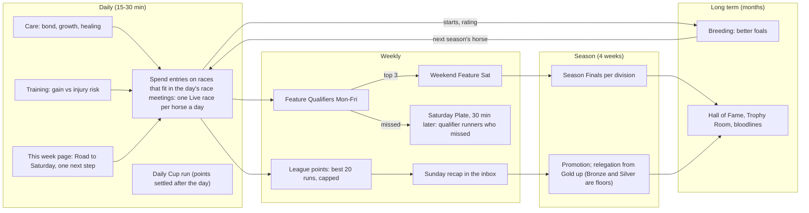
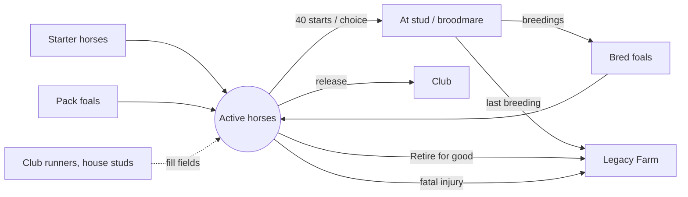
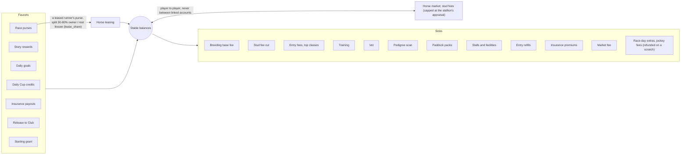
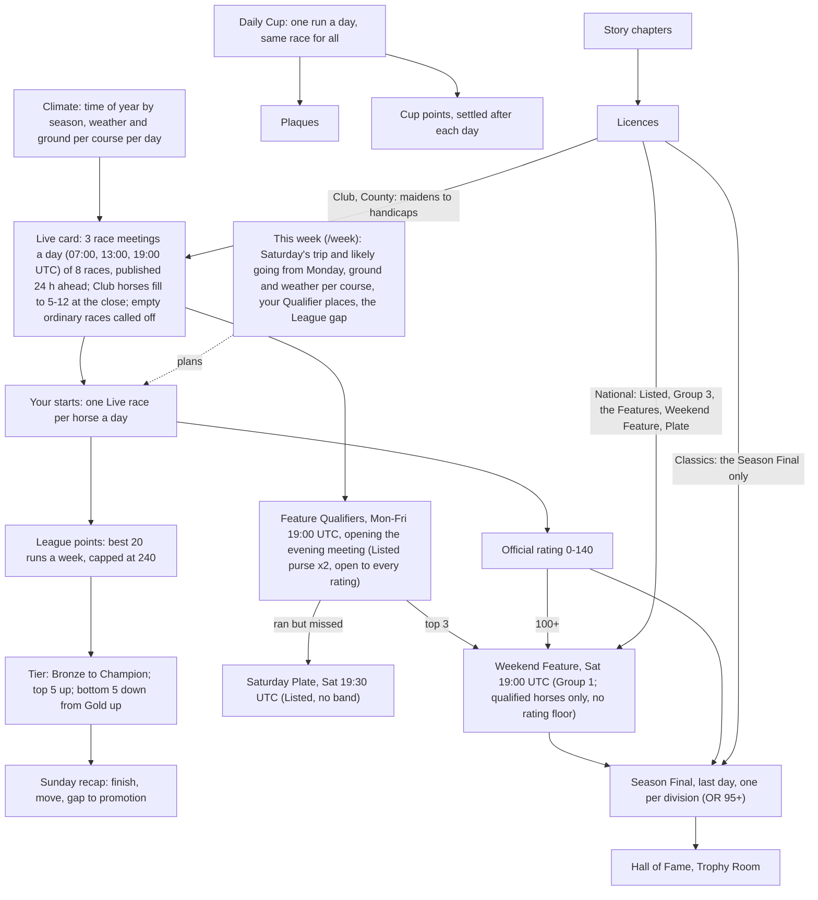
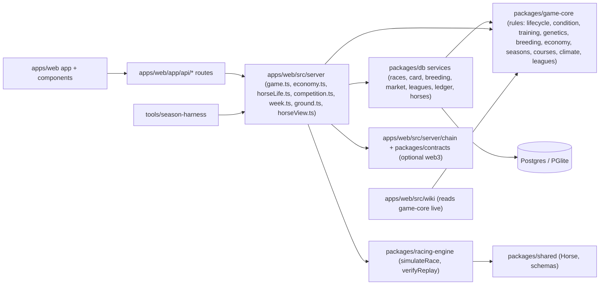

# Post Time: how the game works (systems map)

The operating picture of the game: the loops players live in, how horses and credits flow,
how competition funnels, and where each piece lives in code. Read this before changing a
rule. The companion documents:

- [`KNOBS.md`](KNOBS.md): every tunable value, where it lives and what it moves.
- [`tools/season-harness`](../../tools/season-harness): runs the real game code with simulated
  stables for a season and charts the outcomes. **Every rule change is run through it before
  it ships** (see "How we change the game" at the end).

Diagrams are Mermaid (GitHub renders them).

---

## 1. The four loops

A player lives in four nested loops. Each inner loop feeds a number the next loop is waiting
for. When a loop does not feed the next one, it feels pointless ("a race every few minutes,
but what's the point?").



**Race meetings make the races social.** The Live card runs three meetings a day (07:00, 13:00,
19:00 UTC) of eight races 15 minutes apart, published a day ahead, so one visit a day can enter any
meeting before the next visit. 24 races a day instead of 96 put the same player starts into fewer,
fuller fields: the race list shows how many stables have entered each race, and an ordinary race
nobody entered is called off rather than run by the Club alone (game-core `meetings.ts`, KNOBS §1).

**Scarcity makes the choices.** 10 entries a day, one Live race per horse per day (three
races counting Story), a 40-start career and 4 lifetime breedings turn every action into a
trade-off (KNOBS §2, §3). One Live start a day makes a career last at least 40 days and
makes a bigger string of horses worth having.

---

## 2. A horse's life

```mermaid
stateDiagram-v2
  [*] --> Foal: born (covering + 24 h) or pulled from a pack / starter
  Foal --> Weanling: care sessions
  Weanling --> Yearling: care sessions
  Yearling --> Juvenile: racing age (all care sessions done)
  Juvenile --> Prime: starts
  Prime --> Veteran: starts
  Juvenile --> AtStud: Send to stud / Make a broodmare / career-ending injury
  Prime --> AtStud
  Veteran --> AtStud: or the 40th start
  AtStud --> LegacyFarm: last breeding used (automatic) or Retire for good
  Juvenile --> LegacyFarm: Retire for good
  Prime --> LegacyFarm
  Veteran --> LegacyFarm
  Juvenile --> InMemoriam: fatal race injury (Live races only)
  Prime --> InMemoriam
  Veteran --> InMemoriam
  InMemoriam --> LegacyFarm
  LegacyFarm --> [*]: never deleted; no stall, no racing, no breeding
```



- Racing horses with enough starts can breed while still racing.
- A parent retired by injury can pass on **fragile legs** (dominant gene).
- Geldings "End racing" and never breed.

---

## 3. Horse population: what comes in, what goes out

A breeding game inflates unless horses leave as fast as they arrive. Axie and Zed Run had no
exit; Post Time has several. The target is roughly one horse leaving active play for every
horse born.



Levers: breedings per lifetime and per season, career length, fatal share, regression of
foals toward the family (family limits, ~half of good x good foals land below both parents),
pack supply (crop cap, weekly limits). Harness metrics: `horses.born`, `horses.retired`,
`horses.legacy`, `horses.died`, population by stage.

---

## 4. Credits: faucets and sinks

Stable Credits are never cashed out. They are created by play and destroyed by spending; the
ledger records every movement by kind, so the harness can total them.



Leasing (2026-10-30, KNOBS 11a) creates no credits and, in the beta, moves none between players
directly: there is no upfront fee (`LEASE_FEE_MAX` = 0), so the only flow is a leased runner's
own purse, minted once and split between owner and lessee in one `lease_share` transaction at
settlement (the runner's share of the race's `purse` transaction moves there). Upkeep for a
leased horse is paid by the lessee (the stable that used it). Linked accounts can't lease to each
other; lessees need a 7-day-old account with 10 Live starts; reciprocal leases are flagged.

Purses were halved and a 5% entry fee added on 2026-10-29 (live purses were about 3x the
model's; now about 1.7x for ordinary races, KNOBS "Live vs model mismatches" 1), and the
owner-picked sinks followed (upkeep, race-day extras, jockeys, sponsorship). Latest harness
(sinks2): 81 credits spent per 100 earned, purses 58% of credits earned in play; see
`HARNESS-LOG.md`.

---

## 5. Competition funnel



Race meetings (2026-10-30): the 15-minute card ran 96 races a day for ~100 player starts, so only
40% of races had a player and players were 10% of runners (harness goals45). The card now runs 24
meeting races a day; every calendar race sits in the evening meeting (on the season's last day it
opens at 18:00 for the four Finals). See `HARNESS-LOG.md` (meetings1) for the effect.

Seasons, weather and ground (2026-10-30): the year turns with the racing season (spring, summer,
autumn, winter; season 11 is autumn, a year is 16 weeks). Each of the six courses has its own
weather, a wet/dry Markov chain scaled by its `rainBias`, and a ground moisture that rain raises and
dry days lower (faster where `drainage` is high and in summer); the going follows from moisture and
surface, so a race's weather and going always agree, and frost in winter stops a course's turf for
the day (game-core `climate.ts`, knobs in KNOBS §6a). The Live card puts every race at a course that
races its surface that day with that course's going and weather, calendar races included. The
forecast (This week, `GET /api/ground`) shows the published card's days exactly and a 4-day outlook
computed from the last published day. The climate is seeded from public values, like the card, so
the outlook is a choice of what to show, not a secret. Planning loop: a horse that hates soft ground
waits for a dry spell or runs on the all-weather; a mudlark's season is autumn and winter.

Licences moved on 2026-10-29: the Weekend Feature and the card's Features need the National
licence (they needed Classics, and no harness stable reached a Weekend Feature then). Since
fixes4 the funnel fills: about 180 Qualifier runs and 20-28 Weekend Feature runners a season in
the harness (`HARNESS-LOG.md`). The Weekend Feature's gate is qualifying (top 3 in a Qualifier,
or OR 100+), not a rating floor; only the Season Final keeps OR 95+.

Course character (2026-10-30, racing-engine 1.3.0): the six courses (game-core `courses.ts`) race
differently. A Live card race's course profile is frozen into the field at entry close and sealed
in the result hash; the engine lays the course out back from the post, so the trip decides the
bends. Tight bends cost wide runners ground and make passing harder (Kestrel Downs: front-runners
and low draws), a long home straight lets a kick run cheaper (Saltmarsh: closers), an uphill finish
costs stamina-poor horses most (Harrowgate: stayers) and a downhill one saves them most (Larkspur:
speed). A course moves a running style's win share by 5 points or so (Harrowgate's climb up to 10); no style wins
under 20% or over 45% anywhere, and breed win rates stay where they were (`tools/balance/courses.report.ts`;
knobs in `KNOBS.md` §6). Story, Daily Cup and older races run course-less, as before.

How fields are filled (Club fill, 2026-10-30; owner: "the Club horses that fill in the race are
median and above median"). At entry close the Club fills the empty gates up to the race's target
(5-12). Its runners are honest: a Club horse's stored rating is its real ability mark (ability.ts).
A minted one is seasoned (at the start of its peak window, fully trained, fit), suited to the race's
trip and surface, its genome searched from the race seed until its mark is the target (game-core
`clubFill.ts`). Until then a minted Club horse was an untrained novice stamped with the band's
midpoint, so a "62" ran like a 29, players ran away with races and their ratings inflated; existing
Club horses were recalibrated to their real marks once (db `services/clubFill.ts`). Which horses:
every race but a Story race centres on P, the median real ability mark of the player horses entered;
the Club's window is [P − 2, P + 10], clipped to the race's band, and its targets lean to the bottom
(cubed slices), so about half the Club pack is within a couple of marks of P and one or two
contenders sit near P + 10. A Story race uses its whole band. Free Club horses whose real mark is
in the window are used first; the shortfall is minted. (A first cut, [band middle, max], put the
Club above nearly every player in the upper bands; `HARNESS-LOG.md` clubfill1 vs clubfill2,
`tools/balance/club-fill.report.ts`.) Live handicaps carry no handicap weights (KNOBS mismatch
14a), so a handicap field is only as tight as its band.

---

## 6. Code map: where each system lives



Rules of the road: game-core holds the rules and is pure; db owns state, locking and the
ledger; the server layer composes them for the app. The wiki reads rule numbers from
game-core, so it never goes stale.

---

## 7. How we change the game (Graphs → Harness)

```mermaid
flowchart LR
  idea[Proposed change] --> knob["Find the knob (KNOBS.md)"]
  knob --> graph["Which loop / flow does it move? (this doc)"]
  graph --> base["Harness baseline run"]
  base --> change["Make the change on a branch"]
  change --> run["Harness run, same seed"]
  run --> compare["Compare report: deltas per metric"]
  compare -->|acceptable| ship["Tests, wiki check, commit"]
  compare -->|not| knob
```

1. Name the knob and the loop it serves.
2. Write down the expected effect on two or three harness metrics before running anything.
3. Run the harness baseline and the change with the same seed and cohorts, then compare.
4. Ship only if the deltas match the intent and nothing else moved unexpectedly (credits
   created vs destroyed, horses in vs out, field sizes, qualifiers per week).

### The health dashboard (what "healthy" means for the beta)

| Signal | Healthy range (beta, ~50 stables) | Harness metric |
|---|---|---|
| Credits destroyed / created | 0.85 to 1.15 over a season | `credits.created`, `credits.destroyed` |
| Horses leaving / horses born | about 1 | `horses.*` |
| Real-player runners per Live race | rising; fields not mostly Club runners (beta target since the meetings: 85%+ of Live races with a player, player share 35%+) | `races.fieldSize`, `races.playerShare`, `races.calledOff` |
| Stables that try a Feature Qualifier each week | most grinders, some casuals | `competition.qualifierEntrants` |
| Weekend Feature qualifiers per week | a handful, not zero, not everyone | `competition.featureQualified` |
| Foals below / between / above parents | about 50 / few / 45 (the gamble) | `breeding.foalVsParents` |
| Injuries, fatal | rare and visible | `injuries.bySeverity` |
| Farmer cohort advantage | none measurable | per-cohort balances, linked transfers |
