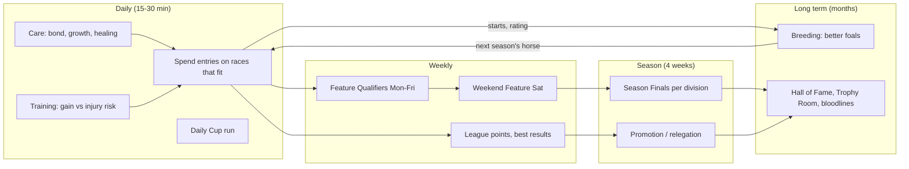
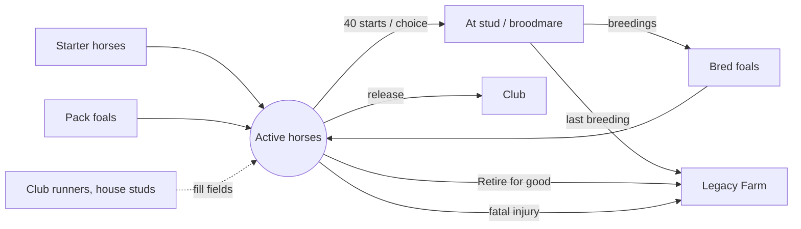
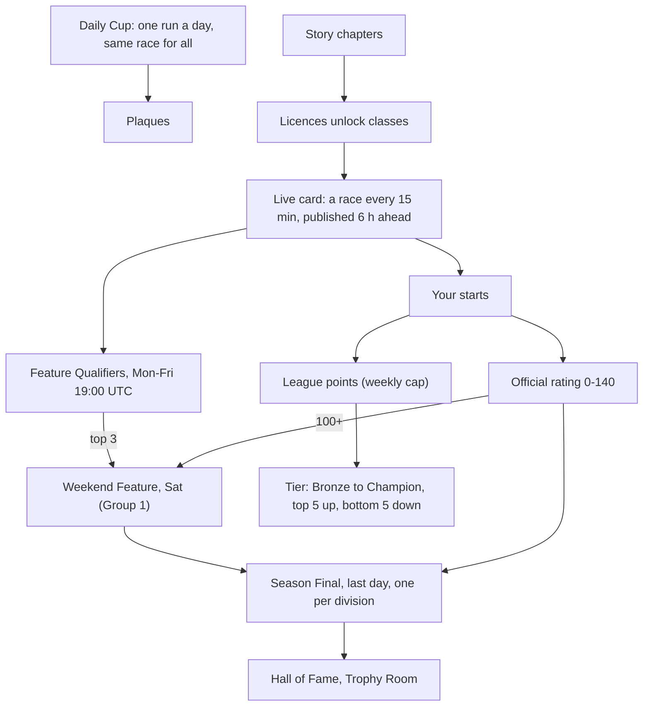
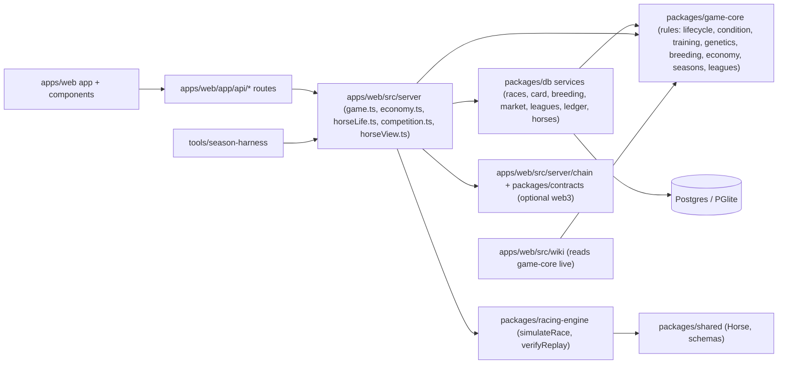

# Post Time: how the game works (systems map)

The operating picture of the game: the loops players live in, how horses and credits flow,
how competition funnels, and where each piece lives in code. Read this before changing a
rule. The companion documents:

- [`KNOBS.md`](KNOBS.md): every tunable value, where it lives and what it moves.
- [`tools/season-harness`](../../tools/season-harness): runs the real game code with simulated
  stables for a season and charts the outcomes. **Every rule change is run through it before
  it ships** (see "How we change the game" at the end).

Diagrams are Mermaid (GitHub renders them).

---

## 1. The four loops

A player lives in four nested loops. Each inner loop feeds a number the next loop is waiting
for. When a loop does not feed the next one, it feels pointless ("a race every few minutes,
but what's the point?").



**Scarcity makes the choices.** 10 entries a day, 3 races per horse per day, a 40-start
career and 4 lifetime breedings turn every action into a trade-off (KNOBS §2, §3).

---

## 2. A horse's life

```mermaid
stateDiagram-v2
  [*] --> Foal: born (covering + 24 h) or pulled from a pack / starter
  Foal --> Weanling: care sessions
  Weanling --> Yearling: care sessions
  Yearling --> Juvenile: racing age (all care sessions done)
  Juvenile --> Prime: starts
  Prime --> Veteran: starts
  Juvenile --> AtStud: Send to stud / Make a broodmare / career-ending injury
  Prime --> AtStud
  Veteran --> AtStud: or the 40th start
  AtStud --> LegacyFarm: last breeding used (automatic) or Retire for good
  Juvenile --> LegacyFarm: Retire for good
  Prime --> LegacyFarm
  Veteran --> LegacyFarm
  Juvenile --> InMemoriam: fatal race injury (Live races only)
  Prime --> InMemoriam
  Veteran --> InMemoriam
  InMemoriam --> LegacyFarm
  LegacyFarm --> [*]: never deleted; no stall, no racing, no breeding
```



- Racing horses with enough starts can breed while still racing.
- A parent retired by injury can pass on **fragile legs** (dominant gene).
- Geldings "End racing" and never breed.

---

## 3. Horse population: what comes in, what goes out

A breeding game inflates unless horses leave as fast as they arrive. Axie and Zed Run had no
exit; Post Time has several. The target is roughly one horse leaving active play for every
horse born.



Levers: breedings per lifetime and per season, career length, fatal share, regression of
foals toward the family (family limits, ~half of good x good foals land below both parents),
pack supply (crop cap, weekly limits). Harness metrics: `horses.born`, `horses.retired`,
`horses.legacy`, `horses.died`, population by stage.

---

## 4. Credits: faucets and sinks

Stable Credits are never cashed out. They are created by play and destroyed by spending; the
ledger records every movement by kind, so the harness can total them.

```mermaid
flowchart LR
  subgraph Faucets
    purses[Race purses]
    story[Story rewards]
    goals[Daily goals]
    cupc[Daily Cup credits]
    ins[Insurance payouts]
    release[Release to Club]
    start[Starting grant]
  end
  subgraph Sinks
    fees[Breeding base fee]
    studburn[Stud fee cut]
    entryfee[Entry fees, top classes]
    trainc[Training]
    vet[Vet]
    scan[Pedigree scan]
    packsc[Paddock packs]
    fac[Stalls and facilities]
    refill[Entry refills]
    prem[Insurance premiums]
    mfee[Market fee]
  end
  Faucets --> wallet((Stable balances))
  wallet --> Sinks
  wallet <-->|player to player| market[Horse market, stud fees]
```



Known imbalance (2026-10-29): live race purses are about 3x the tier purses the economy model
was balanced on (KNOBS "Live vs model mismatches"). The harness measures created vs
destroyed per day and per cohort.

---

## 5. Competition funnel



---

## 6. Code map: where each system lives



Rules of the road: game-core holds the rules and is pure; db owns state, locking and the
ledger; the server layer composes them for the app. The wiki reads rule numbers from
game-core, so it never goes stale.

---

## 7. How we change the game (Graphs → Harness)

```mermaid
flowchart LR
  idea[Proposed change] --> knob["Find the knob (KNOBS.md)"]
  knob --> graph["Which loop / flow does it move? (this doc)"]
  graph --> base["Harness baseline run"]
  base --> change["Make the change on a branch"]
  change --> run["Harness run, same seed"]
  run --> compare["Compare report: deltas per metric"]
  compare -->|acceptable| ship["Tests, wiki check, commit"]
  compare -->|not| knob
```

1. Name the knob and the loop it serves.
2. Write down the expected effect on two or three harness metrics before running anything.
3. Run the harness baseline and the change with the same seed and cohorts, then compare.
4. Ship only if the deltas match the intent and nothing else moved unexpectedly (credits
   created vs destroyed, horses in vs out, field sizes, qualifiers per week).

### The health dashboard (what "healthy" means for the beta)

| Signal | Healthy range (beta, ~50 stables) | Harness metric |
|---|---|---|
| Credits destroyed / created | 0.85 to 1.15 over a season | `credits.created`, `credits.destroyed` |
| Horses leaving / horses born | about 1 | `horses.*` |
| Real-player runners per Live race | rising; fields not mostly Club runners | `races.fieldSize`, `races.playerShare` |
| Stables that try a Feature Qualifier each week | most grinders, some casuals | `competition.qualifierEntrants` |
| Weekend Feature qualifiers per week | a handful, not zero, not everyone | `competition.featureQualified` |
| Foals below / between / above parents | about 50 / few / 45 (the gamble) | `breeding.foalVsParents` |
| Injuries, fatal | rare and visible | `injuries.bySeverity` |
| Farmer cohort advantage | none measurable | per-cohort balances, linked transfers |
