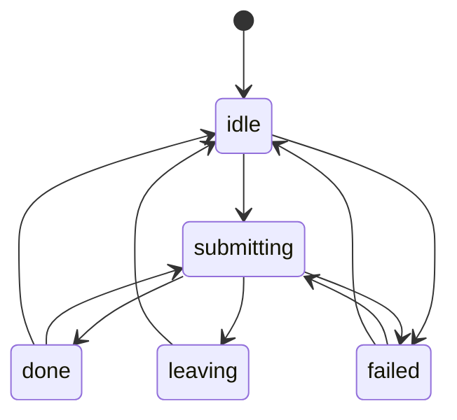
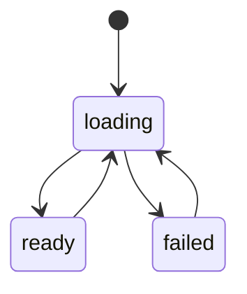
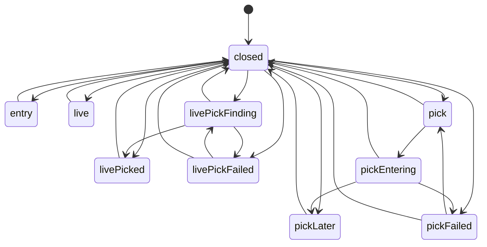
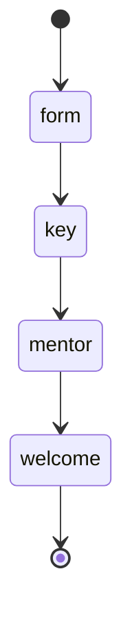
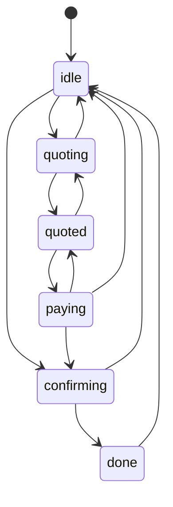
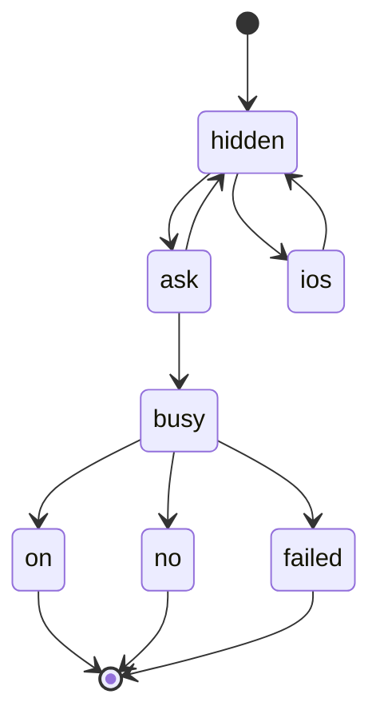
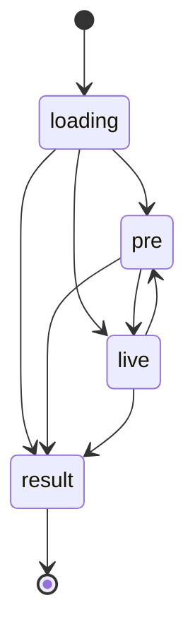
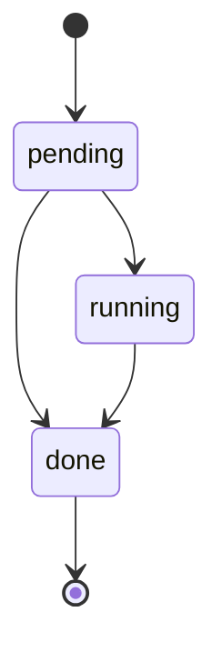
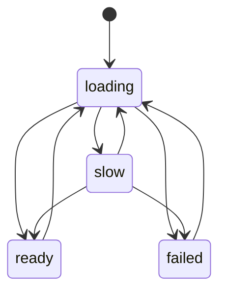
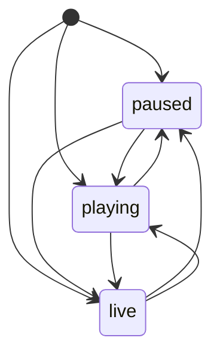

# UI state machines (client)

How the web app's screens model their flows, which flows are explicit machines, and which were
left as plain state on purpose. Server and persisted lifecycles (races, entries, orders...) are in
`docs/state-machines.md`.

## How UI flows are modelled

- A flow is **one typed value**, never a cluster of booleans (`busy` + `error` + `done`...). Its
  states and every allowed move are declared once with `defineMachine` (`@thoroughbred/shared`,
  `packages/shared/src/machine.ts`) in `apps/web/src/lib/machines/` (the race viewer's own in
  `packages/race-viewer/src/machines.ts`).
- Moves go through `moveOr(machine, from, to)` (`lib/machines/guard.ts`): an illegal move **throws
  in dev and tests** and, in production, logs one `console.warn` and is **ignored** (the flow
  stays where it was; a screen never crashes over it).
- Most screens use one of two shared machines through a hook:
  - **`useSubmit()`** (`submit` machine): any button that sends something. `entry.run(task, tag?)`;
    the task resolves `"leaving"` when it navigated away. Gives `busy` (disable the button),
    `status`, `tag` (which of several buttons started it), `error`. A second tap while busy is
    ignored, even in the same tick. A page restored from the back/forward cache leaves `leaving`.
  - **`useLoad(fetcher, key, { retryMs })`** (`load` machine): data a screen waits for, with
    Try again (`reload`) and optional automatic retries. A newer load always wins.
- **UX rule: every waiting state has an exit**: success, a visible error with a retry, or a
  timeout. Server calls go through `api()` or `fetchTimed()` (`lib/fetchTimed.ts`), which give up
  after `API_TIMEOUT_MS` (25 s) with the same "try again" message; non-fetch waits use
  `withTimeout`. A retry of a purchase or bet reuses its idempotency key, so a request that went
  through before the timeout is never charged twice.
- Screens with their own vocabulary (the entry sheet, checkout, founding, the race page, the
  viewer) keep a reducer or a guarded setter, with the machine in `lib/machines/`, testable
  without React.

### Adding a flow

1. Declare it in `apps/web/src/lib/machines/<flow>.ts` with `defineMachine` (`name`, `storedIn`,
   `states`, `initial`, `terminal`, `transitions`, one `describe` sentence per state).
2. Drive it with `useSubmit` / `useLoad`, a reducer, or `setX((from) => moveOr(M, from, to))`.
3. Add it to `UI_MACHINES` (`lib/machines/index.ts`) and give it a test in
   `lib/machines/machines.test.ts` (`machineProblems` must stay empty).
4. Refresh the diagrams below:
   `cd apps/web && BAKE_MACHINES=1 pnpm exec vitest run src/lib/machines/doc.test.ts`
   (without `BAKE_MACHINES` the test fails while this file is stale).

Agents: `UI_MACHINES` is the list to read first; each machine's `describe` says what the player
sees in each state, and `storedIn` where the value lives.

## Inventory

Found by scanning `apps/web/src/components`, `apps/web/app` (client components), `apps/web/src/lib`
and the race viewer for `useState` clusters (`busy`/`loading`/`error`/`done`/`sent`/`failed`),
`phase`/`stage`/`step`/`status`/`mode` strings, discriminated unions and screen-moving effects.

### Made explicit

| Flow | Where | States | Problems found | Decision |
|---|---|---|---|---|
| Submit buttons (shared) | `useSubmit`: EntryForm (Story entry), LiveEntry (Live entry), PlayClient (Register, Race now), StoryScreen (chapter race), ResultsSequence (Race again), Verdict (Try this), LinkClient (Sign in), PacksScreen (pulls), PracticePackCheckout (T-USDG), QuickHub (daily, match, ghost) | idle, submitting, done, leaving, failed | `busy` stayed true after navigating: a page brought back by Back (bfcache) stayed on "Entering…" / "Signing in…" for good; QuickHub used a fetch with no timeout and a bare `router.push` (the 2026-11-01 "Entering…" bug class); the T-USDG checkout made a new idempotency key per tap, so a retry after a timeout could buy twice | `submit` machine + hook; QuickHub on `fetchTimed` + `pushSure`; the purchase key is kept per intent |
| Waiting for data (shared) | `useLoad`: Live entry options, your settled result on a race page; the player store (/api/me) | loading, ready, failed | Live entry options: no timeout and no retry (Enter stayed disabled), and refetched on every player refresh, undoing the horse you had picked; settlement: one failed fetch and the credits / verdict never showed; /api/me: no timeout, and a failure left /play and /link blank forever | `load` machine; Try again on the options; settlement retried after 2/5/10/20 s; `usePlayerLoadFailed` + `PlayerLoadFailed` (Try again) on /play and /link |
| Entry sheet | `EntryProvider` | closed, entry, live, pick, pickEntering, pickLater, pickFailed, livePickFinding, livePicked, livePickFailed | a late Quick Pick result could replace another sheet opened since; tapping Live Quick Pick again while one was in flight entered a second race (an entry each) | `entrySheet` reducer with tokens: stale results dropped; a second tap shows the pick in flight |
| Founding a stable | `PlayClient` (+ ComeBackKey, MentorWelcome, Welcome) | form, key, mentor, welcome | screens moved by free string sets; blank page when /api/me failed | `founding` machine (guarded setter); Register / Race now on `useSubmit`; load failure screen |
| ETH checkout | `PremiumCheckout` | idle, quoting, quoted, paying, confirming, done | no timeout on quote / confirm calls ("Getting a price…" could hang); confirm loop up to 90 hung calls and kept polling after leaving the page | `checkout` machine (guarded setter); `fetchTimed`; confirming gives up after 4 min with "order saved, reload later"; stops on unmount (resumes from the saved order) |
| Phone alerts ask | `PushAsk` (+ `lib/push.ts`) | hidden, ask, ios, busy, on, no, failed | service worker ready / subscribe could hang: "Turning on…" forever | `pushAsk` machine; every step after the browser's prompt has a 20 s limit |
| Race page | `RaceExperience` | loading, pre, live, result (+ finale: pending, running, done) | phase rules implicit; replaying the finale in the viewer hid the results again ("The result is being called…") | phase stays derived (`racePhase`), moves checked per race; finale `done` is sticky |
| Race viewer load | `RaceViewer` (race-viewer) | loading, slow, ready, failed | `ready` + `failed` booleans; "Loading race…" could stay forever; failed had no retry | `viewerLoad` machine; after 30 s "taking longer than usual" + Try again (load carries on); failed gets Try again |
| Playback clocks | `PlaybackClock`, `LiveClock` (race-viewer `playback.ts`) | paused, playing, live | two flags; `live && !playing` would be impossible but unchecked | `playback` machine + a seeded walk over every control asserting the invariant (hot path left untouched) |

### Timeouts added without a new machine

These already had one typed state or a `busy` + `error` pair with a working exit once the
request ends; the only missing exit was a request that never ends. They now use `fetchTimed`:
FeedbackButton, BetaScreen, FairnessPanel (verify), NotificationSettings (save prefs),
PlannerPanel, TotePanel (bet, with the bet key kept per slip for retries; betting settings),
RealToteSlip (permit), UsdgPay, WalletSignIn, WalletLink, MissItCard, Profile (photo upload with
90 s, photo remove), betting settings page, WhatIfButton, HorseLog (load more), the invite gate on
/play (check, invite sign-in), and `useEcoView` (Packs, Market, Breeding, Leases: skeleton ->
error + Try again).

### Skipped, and why

| Flow | Where | Why not a machine |
|---|---|---|
| Market / lease / breeding / claim / sponsor / jockey dialogs | MarketScreen, LeaseBoard, BreedingBarn, ClaimButton, SponsorBoard, JockeyOffer, JockeyActions, HorseLeasePanel, UsdgHorsePanel, UsdgMarket, UsdgListForm, CupScreen, BloodlineNudge, horseLife `common.tsx`, Profile | `busy` + `error` (+ `done`) on `api()` (timed), buttons disabled while busy, `finally` resets: no stuck state. Mechanical move to `useSubmit` is a good follow-up, not a fix |
| WalletSignIn | `chain/WalletSignIn.tsx` | 9 pieces of state around wallet signatures (replace stable, link here, needs stable). Worth a machine next, but it needs a real wallet to test end to end; only the server calls got timeouts here |
| USDG pay | `chain/UsdgPay.tsx` | already one `phase` string (idle, approving, paying, confirming, done) driven by wallet transactions; server calls now timed. Same shape as `checkout`; convert when it is next touched |
| What if? | `whatIf/WhatIfButton.tsx` | already a discriminated union (loading, error, pick, result); got a timeout |
| Miss-it card | `home/MissItCard.tsx` | already one state (ask, sending, done, error); got a timeout |
| Results sequence stages | `results/ResultsSequence.tsx` | a linear, skippable timeline of timers (board, credits, why, next): every stage ends by itself |
| Diorama | `diorama/Diorama.tsx` | render lifecycle (poster, loading, live, still, fallback) with its own fallback; no player action waits on it |
| Mentor, coach marks, onboarding guide | `onboarding/*` | linear pagers and server-driven marks (`guide.ts`); a step index is the right model |
| Foal reveal, login code card, ComeBackKey, LiveWait, notification bell / settings toggles, story `open`, menus | various | local toggles and animations (open/closed, copied, shown) |
| Admin screens | `components/admin/*`, `chain/admin/*` | staff only |
| Live feed | `lib/liveRaceFeed.ts` | a polling client with its own backoff and `final`; the race page's phase is derived from it (see `racePage`) |

## Diagrams

Generated from `UI_MACHINES`; do not edit by hand.

<!-- BEGIN GENERATED: UI_MACHINES (BAKE_MACHINES=1 to refresh) -->

### `submit`

Lives in: useSubmit (React state, apps/web/src/lib/machines/useSubmit.ts).

| State | Initial | Terminal | Moves to | Meaning |
|---|---|---|---|---|
| `idle` | yes |  | `submitting`, `failed` | Nothing sent yet; the button is ready. |
| `submitting` |  |  | `done`, `leaving`, `failed` | The request is out; the button is disabled and shows its busy label. Ends by itself after the API timeout. |
| `done` |  |  | `submitting`, `idle` | It worked and the screen stays: a confirmation shows. |
| `leaving` |  |  | `idle` | It worked and the page is changing (a race page, Home). Back from the back/forward cache returns to idle. |
| `failed` |  |  | `submitting`, `idle` | A visible error (or a check that failed before sending); the button works again, which is the retry. |

### `load`

Lives in: useLoad (apps/web/src/lib/machines/useLoad.ts), the player store (src/lib/player.ts).

| State | Initial | Terminal | Moves to | Meaning |
|---|---|---|---|---|
| `loading` | yes |  | `ready`, `failed` | Fetching; ends by itself after the request timeout. |
| `ready` |  |  | `loading` | The data is here. A refresh goes back to loading with the old data still shown. |
| `failed` |  |  | `loading` | A visible error with Try again (some screens also retry on their own). |

### `entrySheet`

Lives in: EntryProvider (apps/web/src/components/entry/EntryProvider.tsx, useReducer).

| State | Initial | Terminal | Moves to | Meaning |
|---|---|---|---|---|
| `closed` | yes |  | `entry`, `live`, `pick`, `livePickFinding`, `pickLater`, `pickFailed`, `livePicked`, `livePickFailed` | No sheet. A pick that finishes after the sheet was closed reopens it with the outcome. Opening while another sheet is open closes that one first. |
| `entry` |  |  | `closed` | Story entry form for one horse (EntryForm; its button is its own submit flow). |
| `live` |  |  | `closed` | Live entry form for a card race (its options load, then its own submit flow). |
| `pick` |  |  | `pickEntering`, `closed` | Story Quick Pick card: Watch / Skip to result / Watch later. |
| `pickEntering` |  |  | `pickLater`, `pickFailed`, `closed` | The pick is being entered; all three buttons are disabled. Ends by the API timeout at worst. Watch / Skip close the sheet and open the race. |
| `pickLater` |  |  | `closed` | Entered to watch later: when it runs, and Watch it now. |
| `pickFailed` |  |  | `pick`, `closed` | Couldn't enter, with Try again (back to the pick card). |
| `livePickFinding` |  |  | `livePicked`, `livePickFailed`, `closed` | Live Quick Pick: finding and entering the next suitable race. Ends by the API timeout at worst. |
| `livePicked` |  |  | `closed` | Entered: the race, when it runs, the phone alerts ask. |
| `livePickFailed` |  |  | `livePickFinding`, `closed` | Couldn't enter, with Try again. |

### `founding`

Lives in: PlayClient stage (apps/web/app/play/PlayClient.tsx).

| State | Initial | Terminal | Moves to | Meaning |
|---|---|---|---|---|
| `form` | yes |  | `key` | Name and colours; Register (a submit flow: Registering…, or the error with the button working again). |
| `key` |  |  | `mentor` | Your key to come back: the stable name and login code (ComeBackKey). Moves on by itself when there is no code. |
| `mentor` |  |  | `welcome` | The head lad's three short screens (skippable). |
| `welcome` |  | yes | - | The starters arrive; Race now (a submit flow that leaves for the race page) or Walk into the stable. |

### `checkout`

Lives in: PremiumCheckout phase (apps/web/src/components/chain/PremiumCheckout.tsx).

| State | Initial | Terminal | Moves to | Meaning |
|---|---|---|---|---|
| `idle` | yes |  | `quoting`, `confirming` | Quantity and Buy. An order paid before a reload resumes straight into confirming. |
| `quoting` |  |  | `quoted`, `idle` | Getting a price (Getting a price…). Back to idle with the error if it fails or times out. |
| `quoted` |  |  | `quoting`, `paying` | Exact wei held for 5 minutes with a countdown; re-quotes once when it runs out. |
| `paying` |  |  | `confirming`, `quoted`, `idle` | Waiting for the wallet (Confirm in your wallet…). A rejection goes back to the quote (or idle if it expired). |
| `confirming` |  |  | `done`, `idle` | Paid; the server verifies it on-chain. Gives up after a few minutes: the order is saved and resumes on reload. |
| `done` |  |  | `idle` | Delivered; Buy another goes back to idle. |

### `pushAsk`

Lives in: PushAsk state (apps/web/src/components/PushAsk.tsx).

| State | Initial | Terminal | Moves to | Meaning |
|---|---|---|---|---|
| `hidden` | yes |  | `ask`, `ios` | Nothing shown: asked before on this device, alerts off on the server, unsupported, already on, or dismissed. |
| `ask` |  |  | `busy`, `hidden` | Want a ping when it's off? Yes / No thanks. |
| `ios` |  |  | `hidden` | iPhone / iPad in a Safari tab: how to add Post Time to the Home Screen first. |
| `busy` |  |  | `on`, `no`, `failed` | Turning on… (both buttons disabled). Ends with the browser's answer, or a timeout after it. |
| `on` |  | yes | - | Done: this device gets a ping. |
| `no` |  | yes | - | Declined or dismissed: the bell will have it. |
| `failed` |  | yes | - | Didn't work in this browser: the bell will still tell you. |

### `racePage`

Lives in: RaceExperience (derived each render by racePhase: clock + feed).

| State | Initial | Terminal | Moves to | Meaning |
|---|---|---|---|---|
| `loading` | yes |  | `pre`, `live`, `result` | First paint: no client clock yet (a blank status chip). |
| `pre` |  |  | `live`, `result` | Before the off: the paddock / countdown, then the viewer's build-up 32 s out. Entries-open cards refresh themselves until the field locks. |
| `live` |  |  | `pre`, `result` | The broadcast is running; the client only holds frames up to the live edge. |
| `result` |  | yes | - | The finish was broadcast: replay, results (after the finale), settlement, fairness check. |

### `raceFinale`

Lives in: RaceExperience finale (the viewer's onFinale + a 6 s fallback).

| State | Initial | Terminal | Moves to | Meaning |
|---|---|---|---|---|
| `pending` | yes |  | `running`, `done` | Result known, finale not started: results wait (if watched live) at most 6 s. |
| `running` |  |  | `done` | The viewer plays the finale; the results below say the result is being called. |
| `done` |  | yes | - | Results shown. Later finale replays in the viewer don't hide them again. |

### `viewerLoad`

Lives in: RaceViewer load (packages/race-viewer/src/RaceViewer.tsx).

| State | Initial | Terminal | Moves to | Meaning |
|---|---|---|---|---|
| `loading` | yes |  | `ready`, `slow`, `failed` | Loading race… (code, art, horse sheets, GPU programs). Also after a view / setting change rebuilds the scene. |
| `slow` |  |  | `ready`, `failed`, `loading` | Still loading after SLOW_LOAD_MS: the load carries on, with a note and Try again (restarts the load). |
| `ready` |  |  | `loading` | The picture is up; playback and the HUD run. |
| `failed` |  |  | `loading` | The renderer couldn't start: what to do, that the race and result are safe, and Try again. |

### `playback`

Lives in: PlaybackClock / LiveClock playing + live flags (packages/race-viewer/src/playback.ts).

| State | Initial | Terminal | Moves to | Meaning |
|---|---|---|---|---|
| `paused` | yes |  | `playing`, `live` | Not moving: paused, scrubbing, or stopped at the end (ended is a paused clock past the run-out). |
| `playing` | yes |  | `paused`, `live` | Moving on its own at the chosen speed (a replay, or catching up behind the live edge). |
| `live` | yes |  | `paused`, `playing` | Following the broadcast / wall clock at the live edge (always playing too). |

<!-- END GENERATED: UI_MACHINES -->
