# State machines (server and persisted)

Many things in POST TIME have a lifecycle: a race opens, locks, settles; an order is quoted, paid,
fulfilled; a claim is lodged, drawn, claimed. Each lifecycle lives in one `status` / `stage` /
`outcome` value. This doc lists every one of them on the server, says which are now **explicit
machines**, and shows each machine as a diagram generated from the code.

Client screen flows (checkout dialogs, forms, the race viewer) are in
[state-machines-ui.md](state-machines-ui.md).

## What a machine is here

A machine is one `defineMachine({...})` declaration (`packages/shared/src/machine.ts`): its states,
where a new row starts (`initial`), where it ends (`terminal`), every allowed move (`transitions`,
from -> to) and one plain sentence per state (`describe`). It is state-based, not event-based: the
database stores "status = X", so a machine answers "may a row in X become Y?".

- **Registry:** the server machines are in `packages/game-core/src/machines/*.ts`, exported from
  game-core (`gc.raceMachine`, ...) and listed in `SERVER_MACHINES`
  (`packages/game-core/src/machines/index.ts`). Status types come from them
  (`gc.RaceStatus`, `gc.ChainOrderStatus`, ... via `StateOf<typeof machine>`), and the text status
  columns in `packages/db/src/schema.ts` are typed with them (`text("status").$type<M.X>()`).
- **Guard in services:** before a db service writes a new status it calls
  `checkMove(machine, from, to, id)` (`packages/db/src/machines.ts`) with the status it already
  read. In tests and development an illegal move throws `IllegalTransitionError`. In production it
  logs one structured warning (`{"event":"illegal_transition","machine":...,"from":...,"to":...,"id":...}`)
  and the service carries on exactly as before, so a player's request never starts failing because
  of the check. Search the logs for `illegal_transition` to find one.
- **Guarded updates:** an update that does not hold the row lock guards itself with
  `WHERE status IN (fromStates(machine, to))`, so two racing requests can't settle, fulfil or end
  the same row twice.
- **The database agrees:** `packages/db/src/test/machines.test.ts` proves every pgEnum's values and
  every text status CHECK list equal the machine's states, exactly.
- **Derived values** (a phase computed from the clock, a stage computed from counters) get a machine
  too, with a test that the derived value only ever makes legal moves as time or counters grow.

### Adding or changing a machine

1. Declare or edit it in `packages/game-core/src/machines/<area>.ts` (states, initial, terminal,
   transitions, a `describe` sentence for every state) and list it in `SERVER_MACHINES`.
2. Call `checkMove` before every write of the column, and use `fromStates` in guarded updates.
3. A new state in a pgEnum or CHECK needs an additive migration (preview and production share one
   database); the parity test fails until the machine and the database agree.
4. Regenerate the diagrams below:
   `cd packages/game-core && BAKE_MACHINES=1 pnpm exec vitest run src/machines/machines.test.ts`.
   Without it, that test fails while this doc is stale.

## Inventory

Every status-like value on the server and in the pure game rules. "Explicit" means: declared in the
registry, its writes checked, and the database proven to hold exactly its states.

| Lifecycle | Stored in | Files | States | Who moves it | Decision |
|---|---|---|---|---|---|
| race | `races.status` (pgEnum `race_status`) | db `services/races.ts` (`lockFieldTx`, `callOffTx`, `settleRace`, `cancelRace`), `services/card.ts` (tick) | open, locked, settled, cancelled | card tick and request-time lock, settlement, admin cancel | **Explicit.** Every write checked; rows are locked `FOR UPDATE`. |
| raceEntry | `race_entries.status` (pgEnum `entry_status`) | `services/races.ts` (`enterRace`, `scratchEntry`, `scratchInFoalAtLockTx`) | entered, scratched | player scratch, the lock (mare in foal) | **Explicit.** A scratched horse can never re-enter (terminal). |
| raceClaim | `race_claims.status` (text, CHECK) | `services/claiming.ts` | lodged, drawn, lost, claimed, void, refunded | lock (draw), settlement, refunds on scratch / call-off / abandon | **Explicit.** |
| raceCardPhase | derived, never stored | game-core `raceCardPhaseAt`, used by web `server/game.ts` `phaseOf` | open, closed, live, finished | the clock and the broadcast end | **Explicit (derived).** Property test: it only moves forward. |
| horseCareer | `horses.career_status` (pgEnum `career_status`) + DB trigger (migration 0001) | `services/horses.ts` (retire, Legacy Farm), `services/races.ts` (max starts, injury, fatal), `services/breeding.ts` (`retireSpentBreeders`), `services/houseStuds.ts` | racing, retired, pasture | player, settlement, breeding, house studs | **Explicit.** Checked where the row is read; the bulk `retireSpentBreeders` keeps its `WHERE career_status = 'retired'` and the trigger stays the backstop. |
| horseStage | `horses.stage` (pgEnum `horse_stage`) | db `rules.ts` `stageFor`, written in `horses.ts`, `horseLife.ts`, `races.ts` | foal ... veteran | care sessions and starts | **Explicit (derived cache).** Machine + test that `stageFor` only moves forward. Writes are not checked: the value is a pure function of two growing counters, and a check would only warn on old rows after a rule change. |
| pregnancy | `pregnancies.status` (pgEnum `pregnancy_status`) | `services/breeding.ts` | carrying, foaled, lost | foaling (due date) | **Explicit.** `lost` is never written today (reserved). |
| listing | `market_listings.status`, `horse_lease_listings.status` (pgEnum `listing_status`) | `services/market.ts`, `services/leasing.ts`, `services/clubMarket.ts`, `services/horses.ts` | active, sold, cancelled, expired | buyer / lessee, owner, expiry sweep, Club trim | **Explicit.** Bulk updates keep `WHERE status = 'active'`. |
| lease | `horse_leases.status` (text, CHECK) | `services/leasing.ts` (`endLeaseTx`, `sweepLeases`) | active, ended | term end, owner recall, injury, retirement | **Explicit.** Guarded update uses `fromStates`. |
| usdgListing | `usdg_listings.status` (text, CHECK) | `services/usdgMarket.ts` | active, closed, sold, cancelled, expired, unsold | seller, auction close, payment, expiry | **Explicit.** |
| usdgBid | `usdg_bids.status` (text, CHECK) | `services/usdgMarket.ts` | active, offered, won, defaulted, void | auction close, payment, non-payment | **Explicit.** The bid is now read before `won` / `defaulted` (one extra select on those rare paths). |
| usdgOrder | `usdg_orders.status` (text, CHECK) | `services/usdgMarket.ts`, `usdgStud.ts`, `usdgPractice.ts` | pending, paid, fulfilled, expired | chain verification, expiry backstop | **Explicit.** `expired -> paid` is legal: a valid late payment is honoured. |
| jockeyStage | `jockeys.stage` (text) | db `services/jockeys.ts` maintenance, game-core `jockeyStageAt` | apprentice, prime, veteran | time | **Explicit (derived cache).** Column typed; test that the stage only moves forward with time. |
| jockeyContract | `jockey_contracts.status` (text, CHECK) | `services/jockeyContracts.ts` | active, ended | transfer window, buyout, retirement | **Explicit.** |
| jockeyOffer | `jockey_offers.status` (text, CHECK) | `services/jockeyContracts.ts` | open, won, lost, withdrawn | stable, the weekly window | **Explicit.** `withdrawn -> open`: an offer made again in the same window reuses its row. |
| toteBet | `tote_bets.status` (pgEnum `tote_bet_status`) | `services/tote.ts` | open, won, lost, returned, void | pool settlement, scratches, abandoned races | **Explicit.** Settles are `WHERE status IN fromStates(...)` (= `'open'`). |
| racePick | `race_picks.outcome` (text, CHECK) | `services/picks.ts` | open, won, lost, void | scoring once the result is public | **Explicit.** |
| realToteRace | `real_tote_races.status` (text, CHECK) | `services/realTote.ts` | pending ... finalized, void, abandoned | chain events (mirror), seed decision, keeper | **Explicit (mirror).** The chain is the truth: an unexpected order is reported (throws in tests, warns in production), the event is never dropped. |
| chainOrder | `chain_orders.status` (text, CHECK) | `services/betaMoney.ts`, web `server/chain/checkout.ts` | quoted, submitted, paid, fulfilled, expired, rejected | wallet, chain verification, backstop | **Explicit.** Guarded updates use `fromStates`. |
| poolEpoch | `pool_epochs.status` (text, CHECK) | `services/betaMoney.ts` | draft, posted, cancelled | admin, chain verification | **Explicit.** `markEpochCancelled` now only cancels drafts. |
| betaReward | `beta_rewards.status` (text, CHECK) | `services/playtest.ts` | pending, approved, paid, void | admin | **Explicit.** |
| feedback | `feedback.status` (text, CHECK) | `services/playtest.ts` | new, resolved | admin (can reopen) | **Explicit.** No terminal state. |
| pushDelivery | `push_deliveries.status` (text) | `services/push.ts` | pending, then one outcome | the push run | **Explicit.** The outcome update only touches rows still `pending`. |
| season | `seasons.status` (pgEnum `season_status`) | `services/competition.ts` | upcoming, active, closed | nothing today | **Declared, nothing to guard:** rows are inserted `active` and the current season is found by date. Kept so the enum is documented. |
| horse lock | `horses.lock_kind` / `lock_ref` (pgEnum `horse_lock`, null = free) | races, market, USDG, stud services | free, race, market, stud | entry, listing, stud booking | **Left as is.** A mutex owned by another row (race, listing, order), not a lifecycle; the DB trigger guards ownership changes while locked. |
| jockey retirement | `jockeys.retirement_announced_at`, `retired_at` | `services/jockeys.ts` maintenance | active, announced, retired | time | **Left as is.** Two timestamps written once each by one job. |
| single-use tokens | `invite_codes`, `link_codes`, `wallet_challenges`, `referrals` (`used_at`, `revoked_at`, `expires_at`) | accounts, devices, chain services | unused, used / revoked / expired | sign-in, admin | **Left as is.** A timestamp plus `WHERE used_at IS NULL` is the whole machine. |
| injuries, pregnancy due, freshness | `horses.injury` / `injured_until`, `pregnancies.due_at`, planning freshness | game-core `injuries.ts`, `planning.ts` | derived from time | the clock | **Left as is.** Values computed on read. |
| onboarding | `onboarding_states` (`mentor_done_at`, `steps_done_at`, `coach_seen`), `services/guide.ts` steps | onboarding, guide | a checklist | the player | **Left as is.** A set of independent flags, not one state. |
| derived views | ToteBoard `status`, form book `status`, engagement `status`, planner `unpublished`, live cache window, game-core `GameStage` | `tote.ts`, `formBook.ts`, `engagement.ts`, `planner.ts`, web `liveCache.ts`, game-core `lifecycle.ts` | various | computed per read | **Left as is.** Read models over the machines above; nothing stores them. |

## Machines

<!-- BEGIN GENERATED: machines (BAKE_MACHINES=1, packages/game-core/src/machines/machines.test.ts) -->

### race

Stored in: races.status (pgEnum race_status).

| State | Kind | Meaning |
|---|---|---|
| `open` | initial | Taking entries until entriesCloseAt; no field yet. Next: locked, cancelled. |
| `locked` | - | Field frozen at the lock (gates drawn, house horses filled, fieldHash published); waiting to run. Next: settled, cancelled. |
| `settled` | terminal | Simulated, purses paid, seed revealed (the result is public once the broadcast is over). |
| `cancelled` | terminal | Called off (no player runner) or abandoned; entries, fees, claims and bets refunded. |

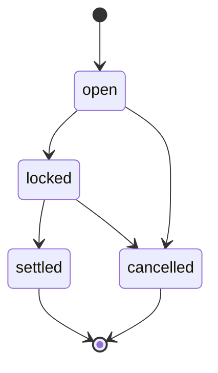

### raceEntry

Stored in: race_entries.status (pgEnum entry_status).

| State | Kind | Meaning |
|---|---|---|
| `entered` | initial | In the race (a player entry holds a stable entry and race-locks the horse). Next: scratched. |
| `scratched` | terminal | Withdrawn before the lock (or a mare found in foal at the lock); everything refunded. |

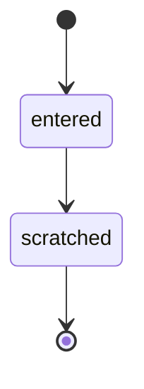

### raceClaim

Stored in: race_claims.status (text, CHECK race_claims_status).

| State | Kind | Meaning |
|---|---|---|
| `lodged` | initial | Price held in escrow; waiting for the lock. Next: drawn, lost, refunded. |
| `drawn` | - | Won the claiming draw at the lock; the horse moves when the race settles. Next: claimed, void, refunded. |
| `lost` | terminal | Lost the draw to another claim on the same horse; refunded. |
| `claimed` | terminal | Settled: the horse moved to the claimant, the old owner was paid (less the fee). |
| `void` | terminal | Drawn but could not complete (fatal injury, no free stall, horse gone); refunded. |
| `refunded` | terminal | The horse was scratched or the race called off or abandoned; refunded. |

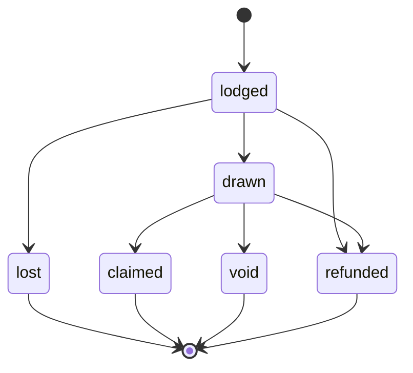

### raceCardPhase

Stored in: derived (game-core raceCardPhaseAt, used by apps/web server/game.ts).

| State | Kind | Meaning |
|---|---|---|
| `open` | initial | Before entriesCloseAt and no field locked: entries open. Next: closed, live, finished. |
| `closed` | - | Entries closed or field locked, before post time: waiting for the off. Next: live, finished. |
| `live` | - | From post time until the finish has been broadcast (no result may leak). Next: finished. |
| `finished` | terminal | The finish has been broadcast: the result can be revealed. |

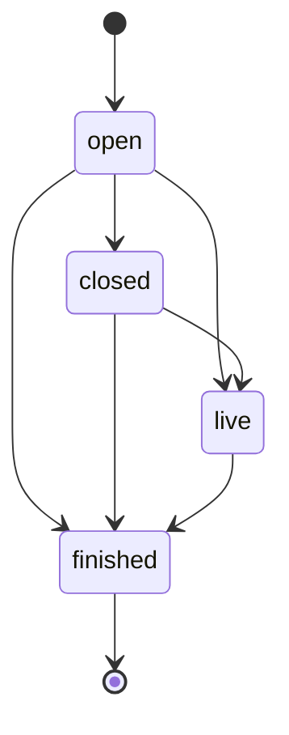

### horseCareer

Stored in: horses.career_status (pgEnum career_status; DB trigger enforces the same moves).

| State | Kind | Meaning |
|---|---|---|
| `racing` | initial | In training and racing (or still in the nursery). Next: retired, pasture. |
| `retired` | - | Racing retirement (choice, max starts, injury): final; may still breed. Next: pasture. |
| `pasture` | terminal | Pasture / Legend on the Legacy Farm: permanent, needs no stall (also a fatal injury). |

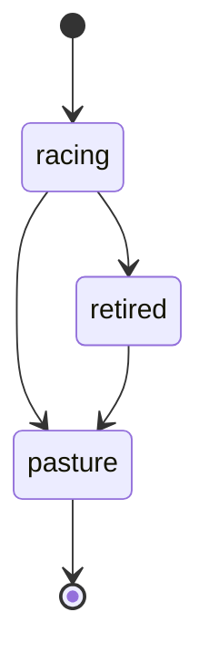

### horseStage

Stored in: horses.stage (pgEnum horse_stage), from stageFor(careSessions, starts).

| State | Kind | Meaning |
|---|---|---|
| `foal` | initial | Nursery: fewer than CARE_TO_WEAN counted care sessions. Next: weanling, yearling, juvenile, prime, veteran. |
| `weanling` | initial | Nursery: weaned, not yet a yearling. Next: yearling, juvenile, prime, veteran. |
| `yearling` | initial | Nursery: not yet enough care sessions to race. Next: juvenile, prime, veteran. |
| `juvenile` | initial | Racing age, early starts. Next: prime, veteran. |
| `prime` | initial | Racing, the middle of the career by starts. Next: veteran. |
| `veteran` | initial, terminal | Racing, late career by starts. |

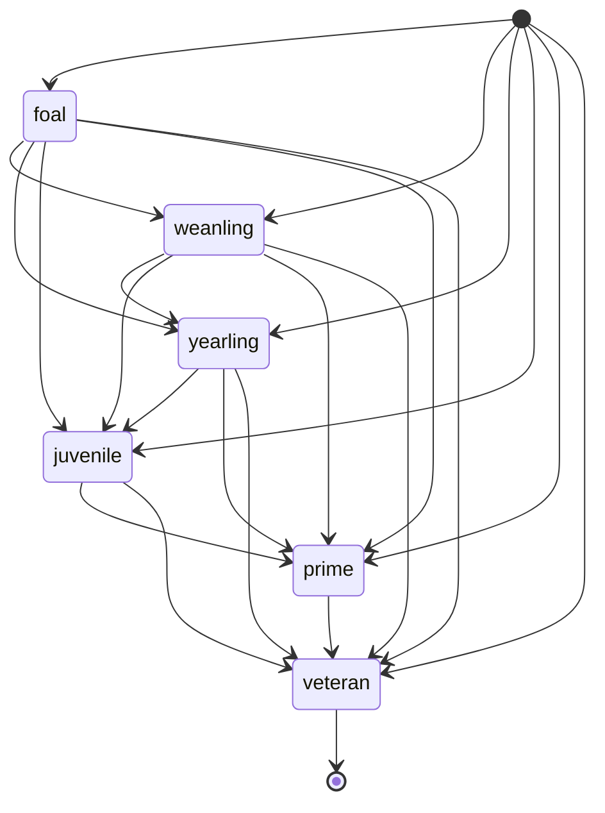

### pregnancy

Stored in: pregnancies.status (pgEnum pregnancy_status).

| State | Kind | Meaning |
|---|---|---|
| `carrying` | initial | In foal until dueAt (the mare can't race or be sold meanwhile). Next: foaled, lost. |
| `foaled` | terminal | The foal was born (foalId set, inheritance seed revealed). |
| `lost` | terminal | Reserved in the enum: no code path writes it today (foals are never lost). |

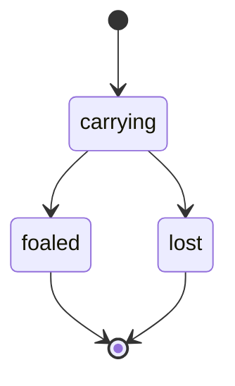

### listing

Stored in: market_listings.status and horse_lease_listings.status (pgEnum listing_status).

| State | Kind | Meaning |
|---|---|---|
| `active` | initial | On offer (a credits listing market-locks the horse) until expiresAt. Next: sold, cancelled, expired. |
| `sold` | terminal | Bought, or for a lease offer taken (the lease row exists). |
| `cancelled` | terminal | Withdrawn by the owner, or the horse stopped being eligible (retired, Club trim). |
| `expired` | terminal | Reached expiresAt unsold; the horse is unlocked. |

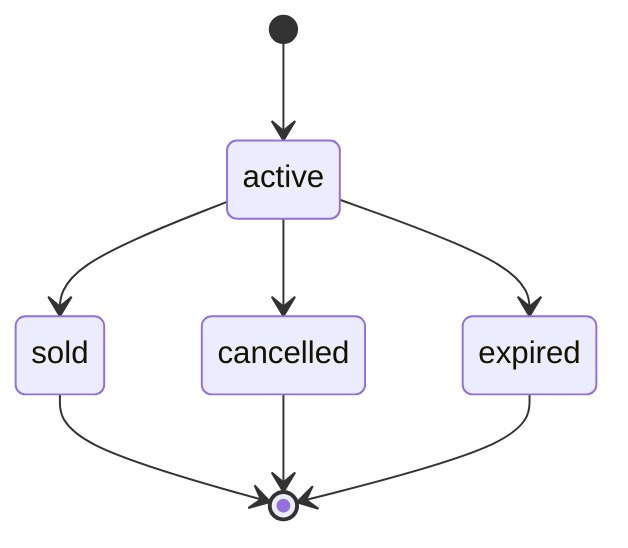

### lease

Stored in: horse_leases.status (text, CHECK horse_leases_status).

| State | Kind | Meaning |
|---|---|---|
| `active` | initial | The lessee races the horse under the agreed terms. Next: ended. |
| `ended` | terminal | Home with its owner (term, returned early, injured, retired or died: end_reason). |

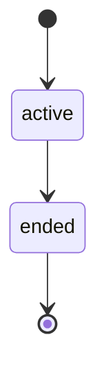

### usdgListing

Stored in: usdg_listings.status (text, CHECK usdg_listings_status).

| State | Kind | Meaning |
|---|---|---|
| `active` | initial | On offer (fixed price, or an auction taking bids until endsAt). Next: closed, sold, cancelled, expired, unsold. |
| `closed` | - | Auction over: a bidder has a payment window (offerOrderId). Next: sold, unsold. |
| `sold` | terminal | Paid on chain (or in practice T-USDG) and the horse moved. |
| `cancelled` | terminal | Withdrawn by the seller. |
| `expired` | terminal | Fixed price: reached endsAt with no live order. |
| `unsold` | terminal | Auction ended with no eligible bidder left. |

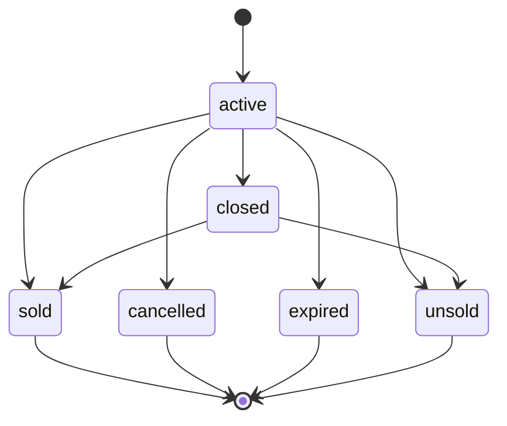

### usdgBid

Stored in: usdg_bids.status (text, CHECK usdg_bids_status).

| State | Kind | Meaning |
|---|---|---|
| `active` | initial | A signed bid standing on an auction. Next: offered, void. |
| `offered` | - | Won the close: a sale order with a payment window exists. Next: won, defaulted. |
| `won` | terminal | Paid; the horse moved to the bidder. |
| `defaulted` | terminal | Did not pay in the window (the bidder is barred for a while). |
| `void` | terminal | The bidder became ineligible, or defaulted on another of their bids. |

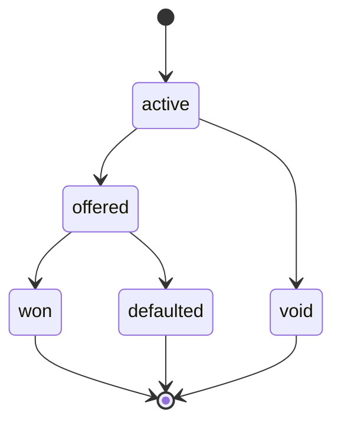

### usdgOrder

Stored in: usdg_orders.status (text, CHECK usdg_orders_status).

| State | Kind | Meaning |
|---|---|---|
| `pending` | initial | Signed for the wallet (tx_hash set once submitted); waiting for the chain. Next: paid, expired. |
| `paid` | - | Payment verified; fulfilment pending or stuck (needs an admin: error says why). Next: fulfilled. |
| `fulfilled` | terminal | Done once: registered, horse moved, or covering made. |
| `expired` | - | Deadline (plus grace) passed with no payment seen; a late valid payment still pays it. Next: paid. |

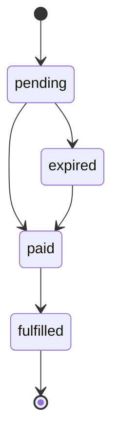

### jockeyStage

Stored in: jockeys.stage (text), from jockeyStageAt(bornAt, now).

| State | Kind | Meaning |
|---|---|---|
| `apprentice` | initial | Early career: claims weight off handicap marks. Next: prime, veteran. |
| `prime` | initial | The middle of the riding career. Next: veteran. |
| `veteran` | initial, terminal | Late career; retirement is announced, then happens, from here. |

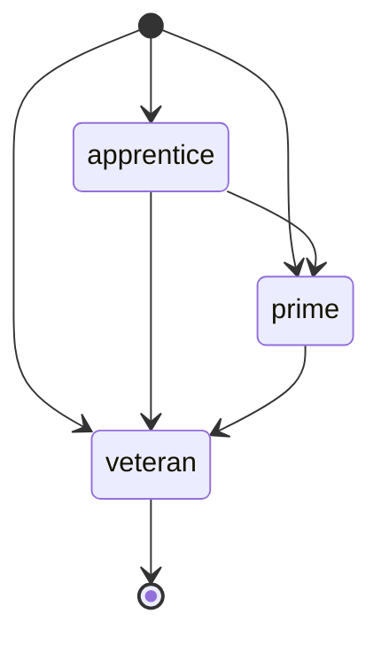

### jockeyContract

Stored in: jockey_contracts.status (text, CHECK jockey_contracts_status).

| State | Kind | Meaning |
|---|---|---|
| `active` | initial | The jockey rides for the stable; wages are paid weekly. Next: ended. |
| `ended` | terminal | Ended at a transfer window, by a buyout, or by retirement (ended_why). |


### jockeyOffer

Stored in: jockey_offers.status (text, CHECK jockey_offers_status).

| State | Kind | Meaning |
|---|---|---|
| `open` | initial | Waiting for the window to run; the signing fee is in escrow. Next: won, lost, withdrawn. |
| `won` | terminal | The jockey chose this offer at the window: the contract started, the fee burned. |
| `lost` | terminal | The jockey chose elsewhere (or nobody); the fee came back. |
| `withdrawn` | - | Taken back before the window; the fee came back (can be offered again this week). Next: open. |

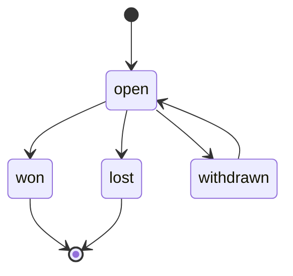

### toteBet

Stored in: tote_bets.status (pgEnum tote_bet_status).

| State | Kind | Meaning |
|---|---|---|
| `open` | initial | Stake held in escrow until the race settles. Next: won, lost, returned, void. |
| `won` | terminal | Settled: the horse won (or placed) and the pool paid out. |
| `lost` | terminal | Settled: the selection did not win (or place). |
| `returned` | terminal | Settled with no winner in the pool: the stake came back. |
| `void` | terminal | Refunded: the horse was scratched, the race abandoned, or the pool voided (void_reason). |

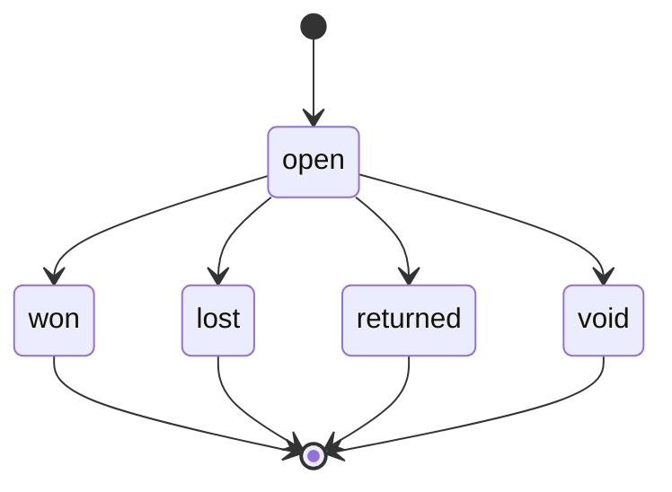

### racePick

Stored in: race_picks.outcome (text, CHECK race_picks_outcome).

| State | Kind | Meaning |
|---|---|---|
| `open` | initial | Picked; waiting for the result to be public. Next: won, lost, void. |
| `won` | terminal | The pick won: points scored. |
| `lost` | terminal | The pick did not win. |
| `void` | terminal | The race was called off or the pick did not run. |

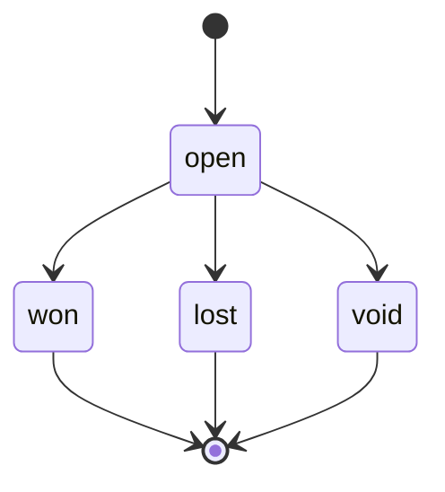

### realToteRace

Stored in: real_tote_races.status (text, CHECK real_tote_races_status).

| State | Kind | Meaning |
|---|---|---|
| `pending` | initial | Flagged for a real-money pool; the market is not created on chain yet. Next: open, abandoned, void. |
| `open` | - | MarketCreated: bets accepted until the market closes. Next: entropy_locked, abandoned, void. |
| `entropy_locked` | - | EntropyLocked: betting closed, the entropy block chosen. Next: sealed, abandoned, void. |
| `sealed` | - | EntropySealed: the entropy is known; the race runs on the final seed. Next: result_posted, abandoned, void. |
| `abandoned` | - | The race ran on its server seed: the market must be voided (refunds). Next: void. |
| `result_posted` | - | ResultPosted: in the challenge window (attest or correct). Next: finalized, abandoned, void. |
| `finalized` | terminal | MarketFinalized: winners can claim. |
| `void` | terminal | MarketVoided (or never opened): stakes refundable. |

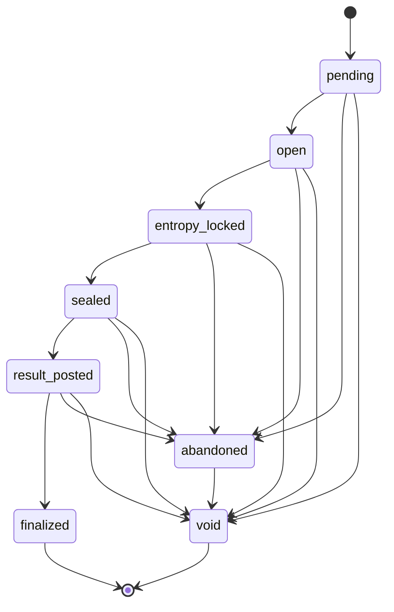

### chainOrder

Stored in: chain_orders.status (text, CHECK chain_orders_status).

| State | Kind | Meaning |
|---|---|---|
| `quoted` | initial | Price quoted and signed (EIP-712); waiting for the buyer's transaction. Next: submitted, paid, expired, rejected. |
| `submitted` | - | The wallet returned a tx hash; waiting for confirmations (a wrong hash goes back to quoted). Next: quoted, paid, expired, rejected. |
| `paid` | - | Payment verified on chain; the pack pulls are being granted (retried until done). Next: fulfilled. |
| `fulfilled` | terminal | Every pull granted, once. |
| `expired` | - | The quote deadline passed unpaid (a late valid payment still pays it). Next: submitted, paid, rejected. |
| `rejected` | terminal | The transaction failed or did not pay this order. |

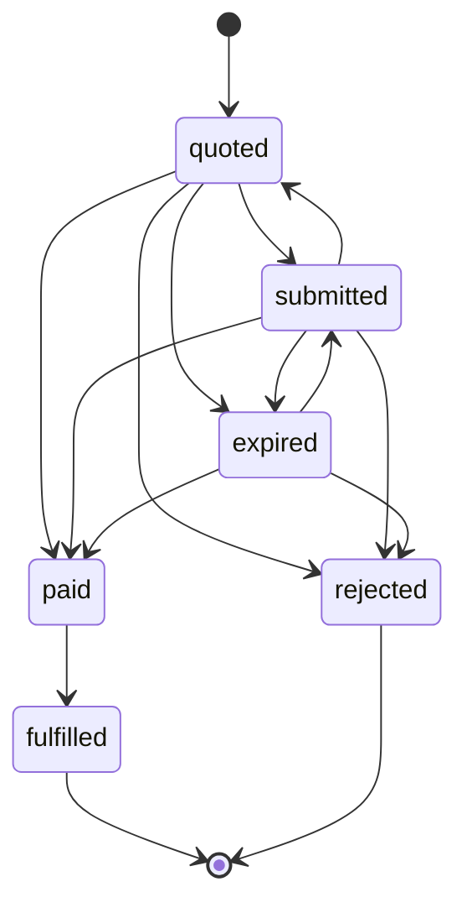

### poolEpoch

Stored in: pool_epochs.status (text, CHECK pool_epochs_status).

| State | Kind | Meaning |
|---|---|---|
| `draft` | initial | Allocations computed; the Merkle root is not on chain yet. Next: posted, cancelled. |
| `posted` | terminal | The root is on chain (verified against the contract): final. |
| `cancelled` | terminal | Dropped before posting. |

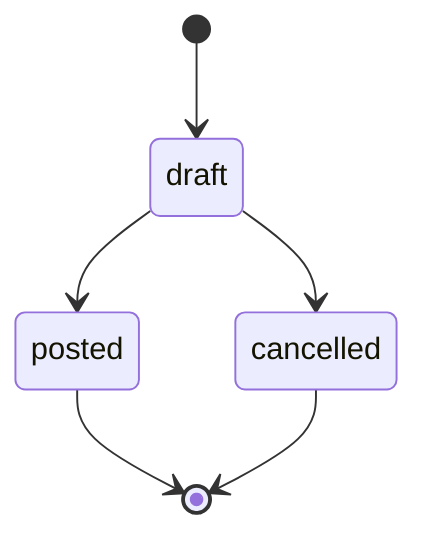

### betaReward

Stored in: beta_rewards.status (text, CHECK beta_rewards_status).

| State | Kind | Meaning |
|---|---|---|
| `pending` | initial | Earned; waiting for an admin. Next: approved, void. |
| `approved` | - | Approved for the next manual payout (CSV export). Next: pending, paid, void. |
| `paid` | terminal | Paid on chain (tx hash recorded): final. |
| `void` | - | Not paid (can be set back to pending). Next: pending. |

```mermaid
stateDiagram-v2
  [*] --> pending
  pending --> approved
  pending --> void
  approved --> pending
  approved --> paid
  approved --> void
  void --> pending
  paid --> [*]
```

### feedback

Stored in: feedback.status (text, CHECK feedback_status).

| State | Kind | Meaning |
|---|---|---|
| `new` | initial | Sent by a tester; not handled yet. Next: resolved. |
| `resolved` | - | Handled by an admin (resolved_at set); can be reopened. Next: new. |

```mermaid
stateDiagram-v2
  [*] --> new
  new --> resolved
  resolved --> new
```

### pushDelivery

Stored in: push_deliveries.status (text).

| State | Kind | Meaning |
|---|---|---|
| `pending` | initial | Claimed for delivery by this run. Next: sent, failed, off, device_off, quiet, cap, duplicate, stale, held. |
| `sent` | terminal | Delivered to at least one device. |
| `failed` | terminal | Every device refused it. |
| `off` | terminal | The player switched this kind of alert off. |
| `device_off` | terminal | No device subscribed. |
| `quiet` | terminal | Inside the player's quiet hours. |
| `cap` | terminal | Over the daily cap. |
| `duplicate` | terminal | A newer or already-sent alert covers it. |
| `stale` | terminal | No longer useful (race off, already watched, Story race). |
| `held` | terminal | Came out of a race whose result the player has not watched yet (no spoiler). |

```mermaid
stateDiagram-v2
  [*] --> pending
  pending --> sent
  pending --> failed
  pending --> off
  pending --> device_off
  pending --> quiet
  pending --> cap
  pending --> duplicate
  pending --> stale
  pending --> held
  sent --> [*]
  failed --> [*]
  off --> [*]
  device_off --> [*]
  quiet --> [*]
  cap --> [*]
  duplicate --> [*]
  stale --> [*]
  held --> [*]
```

### season

Stored in: seasons.status (pgEnum season_status).

| State | Kind | Meaning |
|---|---|---|
| `upcoming` | initial | Declared but not started (not written by any code path today). Next: active. |
| `active` | initial | The season in play (rows are inserted active). Next: closed. |
| `closed` | terminal | Finished (not written by any code path today; seasons end by date). |

```mermaid
stateDiagram-v2
  [*] --> upcoming
  [*] --> active
  upcoming --> active
  active --> closed
  closed --> [*]
```

<!-- END GENERATED: machines -->
