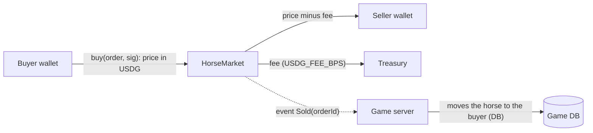
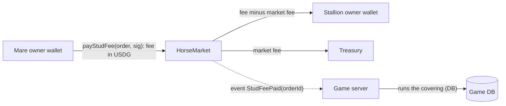

# USDG horse marketplace and auctions (beta, testnet first)

**Owner decision (2026-10-29):** horses can be bought, sold and auctioned for **USDG** (Paxos's
dollar stablecoin on Robinhood Chain; there is no native USDC there, see `docs/web3.md`).
Competitive play and race prizes stay in Stable Credits; the $1,000 giveaway is not part of
this. **Testnet first** while the owner gauges the first users; switching to mainnet is
configuration plus the legal and identity gates below.

This reverses the earlier rule "nothing bought with money can be turned back into money" for
horses that are **registered** for the dollar market. Stable Credits themselves stay closed:
never bought, sold, bridged or transferred for money.

**Status (2026-10-30): built, not deployed.** Contract `packages/contracts/contracts/HorseMarket.sol`
(+ `scripts/deploy-horse-market.ts`), rules and knobs `packages/game-core/src/usdgMarket.ts`, DB
`packages/db/src/services/usdgMarket.ts` (migration `0011_usdg_market`), server
`apps/web/src/server/chain/usdg*.ts`, API `/api/usdg/*` and `/api/admin/usdg`, UI Sales → USDG tab
and the horse page panel, wiki page `usdg-market`. With `WEB3_ENABLED` off the market runs on a mock
chain in dev and tests (payments simulated); production shows "coming soon" until
`HORSE_MARKET_ADDRESS` is set. Implementation choices: registration goes through `HorseMarket.register`
(one contract, one event scanner, one fulfilment path), not a PremiumStore SKU (the store holds funds
until a treasurer withdraws; the market never does). Orders also carry the `token` (allow-list check).
A fixed-price buy reserves the lot for one buyer for 15 minutes so two people can never pay for one horse.

## Who can sell for USDG

A horse joins the USDG market only once it is **registered**:

- owned by the seller's stable, racing age, at least `USDG_MIN_STARTS` Live starts (default 5),
  not on the Legacy Farm, not entered in a race or listed for credits;
- not a starter, gift foal or Club-bred horse (bound horses are never tradeable), and not a
  Premium-pack pull itself (its foals can be);
- the seller has a verified account (18+ ToS) and a linked wallet (SIWE, one wallet per
  account);
- the seller pays a **registration fee** in USDG (default 2 USDG), a sink that makes farming
  horses with free credits to cash out unprofitable.

A registered horse trades **only for USDG** from then on (no credits/USDG arbitrage). Unregistered
horses keep the credits auction house.

## Money flow: no custody, one direction per sale



- **Horses are not NFTs.** They live in the game database; the chain carries the payment and a
  public receipt. The server moves ownership only after verifying the `Sold` event (same
  pattern as `PremiumStore` purchases: order row written first, idempotent fulfilment, backstop
  scanner for paid-but-unfulfilled orders).
- **The contract never holds funds.** `buy` pulls USDG from the buyer and pays the seller and
  the treasury in the same transaction. No balances, no withdrawals, no refunds on-chain.
- **Signed orders.** The server signs an EIP-712 `SaleOrder {orderId, horseRef, seller, buyer,
  price, fee, deadline}` only after checking the listing, both accounts, links between them
  (linked accounts can't trade), the resale lock and the price bounds. Single-use `orderId`.

## Auctions without escrow

Holding bidders' money in a contract means refunds and custody, so auctions settle like a
sealed second chance instead:

1. The seller lists with a reserve and an end time (24-72 h).
2. Bids are **off-chain, signed by the bidder's wallet** (EIP-712 `Bid {listingId, amount,
   bidder, nonce}`), checked by the server (wallet linked, not linked to the seller, amount >=
   reserve and > current best + increment). The board shows the best bid live.
3. At the close, the top bidder gets a signed `SaleOrder` at their bid with a **payment window**
   (default 24 h) and calls `buy`.
4. If they don't pay, the order expires, they are barred from USDG bidding for a period, and the
   next bidder is offered the horse at their own bid.

## USDG stud fees for registered stallions

**Owner decision (2026-10-30):** ordinary breeding stays in Stable Credits for everyone. The owner of
a stallion **registered** for the USDG market may stand him at stud for a **USDG fee instead of a
credits fee** (never both: `horses.stud_fee_usdg`, a CHECK keeps it exclusive with `stud_fee`). A
mare owner who wants that covering pays the fee straight to the stallion's owner, minus the same
`USDG_FEE_BPS` market fee to the treasury, through `HorseMarket.payStudFee(StudOrder, sig)`: the same
no-custody pattern as a sale. **Status (2026-10-30): built, not deployed** (ships with the market).



- **Setting the fee** (`setUsdgStudFee`, `POST /api/usdg/stud-fee`): entire stallion, not on the Legacy
  Farm, registered, owner has a linked wallet; fee within `USDG_STUD_FEE_MIN`..`USDG_STUD_FEE_MAX`
  (default $1-$500). Setting a credits fee (`setStudFee`) clears the USDG fee and vice versa; a sale,
  release to the Club, death or the Legacy Farm clears both.
- **Booking (quote)** (`quoteUsdgStud`, `POST /api/usdg/stud`): every rule `breed()` applies (kinship,
  sexes, eligibility, mare once per season and in foal, stallion per-season and lifetime limits, stall
  for the foal) plus linked accounts refused (`areLinked` + fraud event) and both wallets present and
  different. The order row (`usdg_orders.kind = 'stud'`, `horse_id` = stallion, `mare_id`, seller =
  the stallion owner and his wallet) is written first. It **holds a slot**: live stud orders count as
  used coverings of the stallion for this season and for life (`studHoldsOf`), in `breed()`, in the
  next booking and in the barn's status, so nobody can over-book him. The **mare is locked** to the
  order (`lock_kind 'stud'`) for the payment window (`USDG_QUOTE_TTL_MS`, 15 min): she can't race, be
  listed, sold or covered meanwhile. The **credits base fee** every covering pays is held in escrow.
  A stallion with live bookings can't be listed for sale.
- **Fulfilment** (`fulfilUsdgStudOrder`) only after `StudFeePaid` is verified (our market, orderId,
  stallionRef, mareRef, payer, stallion owner, price, fee, confirmations). One transaction; the
  covering runs through `breeding.ts coverTx` with every rule re-checked, the escrowed base fee is
  burned, the mare unlocked; idempotent per order (`usdg-stud:<orderId>` idempotency key on the
  breeding event, `usdg_orders.breeding_event_id` unique). The stallion owner gets an inbox note.
- **When the covering can't happen at fulfilment** (rare races: the stallion died or went to the
  Legacy Farm, a stall filled, the payment arrived after the booking lapsed...): the order stays
  `paid`, flagged `refund due: <why>` for an admin refund from the treasury (**no on-chain refund**:
  money flows one way), the booking is released (mare unlocked, base fee returned), and an alert is
  raised (`fraud_events.kind = 'usdg_stud_refund_due'`, severity 3, the admin attention list, an
  inbox note to the payer, a server log line).
- **Expiry and backstop:** unpaid bookings expire after deadline + grace and release the booking;
  the backstop scanner looks for `StudFeePaid` by orderId like the other kinds.
- **Foals** of USDG coverings are ordinary foals of the mare's owner; they can register later like
  any horse.
- **UI:** the stud book and the barn show the dollar fee; the preview for a USDG stallion shows "Pay
  N USDG to <stable>" with the USDG pay widget (simulated on the mock chain); the stallion owner's stud
  form switches a registered stallion between a credits and a USDG fee. Wiki: `usdg-market#stud-fees`
  and `breeding-basics`.

## Contract: `HorseMarket.sol` (packages/contracts)

- AccessControl (admin, signer), Pausable, ReentrancyGuard, EIP712 ("PostTimeHorseMarket", "1").
- `buy(SaleOrder order, bytes sig)`: checks signer, `msg.sender == order.buyer`, deadline,
  unused `orderId`, `fee <= price`, `fee` matches `feeBps` within rounding; then
  `safeTransferFrom(buyer, seller, price - fee)` and `safeTransferFrom(buyer, treasury, fee)`;
  emits `Sold(orderId, horseRef, seller, buyer, price, fee)`.
- `register(RegistrationOrder order, bytes sig)`: pays the registration fee to the treasury and
  emits `Registered(orderId, horseRef, owner)`. (Or reuse `PremiumStore.purchase` with a
  `horse_registration` SKU: choose whichever keeps one fulfilment path.)
- Token allow-list: USDG only (6 decimals), exact-amount checks (fee-on-transfer safety).
- Admin: set fee bps (cap 10 %), treasury, pause. No function moves funds out of the contract
  because it never holds any.
- `payStudFee(StudOrder order, bytes sig)`: `StudOrder {orderId, stallionRef, mareRef, stallionOwner,
  payer, token, price, fee, deadline}`; same checks as `buy` (payer = msg.sender, window, allow-list,
  fee within rounding, no self-pay, signer), then `price - fee` to the stallion owner and `fee` to the
  treasury; emits `StudFeePaid(orderId, stallionRef, mareRef, payer, stallionOwner, price, fee)`.
  OrderIds are single-use across all three kinds.
- Tests: signature, replay, deadline, wrong buyer, pause, fee math, exact amounts; the
  byte-compatible TypeScript adapter (`packages/contracts/adapter`) for hashing orders.

## Server and database (packages/db, apps/web)

- Tables: `usdg_registrations`, `usdg_listings` (fixed price or auction, reserve, ends at,
  status), `usdg_bids`, `usdg_orders` (pending / paid / fulfilled / expired, tx hash).
- Services: register (quote + fulfil), list / delist, bid, close auction (offer to top bidder,
  then next), quote a sale order, fulfil on `Sold`, backstop scan, expire stale orders.
- Rules reused from the credits market: resale lock, listing time limit, horse locks (a listed
  horse can't race or breed), linked-account refusal, verified seller.
- Price bounds: a floor of `USDG_MIN_PRICE` (e.g. 1 USDG) and no ceiling (dollar prices are
  set by players), but the server flags sales far from recent comparable prices for review
  (wash-trading signal).

## UI

- Sales: a **USDG** tab beside the credits auction house: registered lots, fixed price or live
  auction board, the dollar price with the token amount, fee and what the seller receives.
- Horse page: "Register for the USDG market" (requirements checklist, fee), then list or
  auction.
- Wallet connect and network switch (existing SIWE flow); testnet faucet link on testnet.
- Practice mode: T-USDG balance with the badge, a wallet chip, the explainer, one "Pay N T-USDG"
  button per order; no network switch, no faucet (see "Practice mode").

## Practice mode (T-USDG, the closed beta)

**Owner decision (2026-10-31):** "For the testers I don't want them to spend money yet... pretend
the USDG is just test, like credits, but shown as USDG, but they still need to log in using a
wallet." Turned on explicitly with **`USDG_MODE=practice`** (exactly that value; a near miss such
as `Practice` is a configuration error, never a silent fallback to real money). It wins over
`WEB3_ENABLED`, `HORSE_MARKET_ADDRESS` and every key: in practice mode nothing touches a chain
(no RPC, no contract write, no signer, no ETH price feed).

**The currency.** Players see **T-USDG** everywhere ("120 T-USDG", badge "T-USDG · test money,
no real value"), never plain "USDG" or a dollar sign. One balance per account, in the game's
double-entry ledger as currency `TUSDG` (6 decimals like USDG), shared by the market, USDG stud
fees, Premium Packs and the tote's T-USDG pools. A ledger transaction can never mix currencies,
so T-USDG is never convertible to or from Stable Credits; it is never withdrawable or purchasable,
and there is no faucet.

- **Grant:** `PRACTICE_USDG_GRANT` = **100 T-USDG**, once per account (idempotency key
  `usdg-practice:grant:<account>`), on the first wallet sign-in, founding or wallet link while
  practice mode is on (and lazily when a wallet holder opens a T-USDG view). Refused outside
  practice mode.
- **Admin top-up:** `POST /api/admin/usdg { action: "practice_topup", stable, amount, key }`
  (stable name or account id, decimal T-USDG, idempotent per key, max 10,000 per top-up).
- **Wallet required:** every T-USDG action needs a verified wallet (the existing SIWE sign-in or
  link; signing is free). Auction bids are still EIP-712 signatures from the linked wallet,
  signed on whatever network the wallet is on (no network switch) and verified locally.
- **Payments:** orders keep every market rule (requirements, reservation, 15-minute hold, 5 % fee,
  auction window and fallback, non-payer bar, the 12 h stallion rest). Instead of a chain payment,
  `POST /api/usdg/orders/<id>/practice-pay` moves the T-USDG and runs the normal fulfilment in
  **one database transaction**: registration fee to the practice burn; sale or auction price to
  the seller minus the 5 % fee (fee to the burn); stud fee to the stallion owner minus 5 %. If the
  order can't be delivered, the whole transaction rolls back and nothing is charged; it lapses
  through the normal expiry (lot, stallion slot and mare released). A short balance is refused
  **before** anything is held (lot, mare, order row). Practice orders carry a placeholder market
  address (`0x…7e57`), so a real order can never be paid with test money.
- **Premium Packs:** the pack's USD price in T-USDG (1 T-USDG = 1 USD, 4.99 T-USDG by default),
  `POST /api/checkout/practice`. Same checks as ETH checkout (wallet, geo-block, 5 a week incl.
  open orders, the $50 beta lifetime cap counted as 50 T-USDG, free stall, foal crop), the same
  seeded, committed pulls with published odds and pity, idempotent per order id, charged in the
  same transaction as the order row and the pulls. **No affiliate commission and no Prize Pool
  share** on practice purchases (decision taken: practice money pays nobody).
- **Horses and trophies** are owned in the game only. No NFTs.

### Real-money path audit (practice mode)

| Path | Code | Real money in practice mode? | What happens instead |
|---|---|---|---|
| USDG market: registration, fixed-price buy, auction settlement | `apps/web/src/server/chain/usdg.ts`, `usdgChain.ts` (`PracticeUsdgChain` throws on every method), db `services/usdgPractice.ts` | No | Paid in T-USDG via `practice-pay`; `confirm` and `mock-pay` refused; nothing signed |
| USDG stud fees | `usdg.ts` `bookUsdgStud`, db `usdgStud.ts` | No | Stud fee in T-USDG to the stallion owner minus 5 %; credits base fee unchanged |
| Refunds, expiries, backstop | `usdg.ts` `practiceBackstop` | No | Closes auctions and expires practice orders; never looks for chain payments |
| Premium Store / packs checkout (ETH) | `apps/web/src/server/chain/checkout.ts` (`quoteCheckout`, `confirmCheckout`, `checkoutBackstop`, `resumeOrders`) | No | ETH quote and confirm refused (503 `coming_soon`); backstop does nothing; packs bought with T-USDG (`practiceCheckout`) |
| Premium Pack for credits (`PREMIUM_PACK_DEMO`) | `apps/web/src/server/economy.ts` `pull` | No | Refused in practice mode: the pack is bought with T-USDG only |
| Prize Pool (PrizePool contract, weekly epochs, claims) | `apps/web/src/server/chain/pool.ts` | No | Draft, server post and wallet-post record refused; the pool page says it is off; no sale adds a pool share |
| Affiliate commissions (ETH, from the store contract) | `services/affiliates.ts` `referralPlan` / `recordReferralEarnings`, `apps/web/src/server/chain/affiliates.ts` | No | Only paid by ETH purchases, which are refused; practice packs carry no referrer; `/invite` says no commission is paid (the credits invite reward stays) |
| Manual tester payouts (beta-money ledger) | `apps/web/app/api/admin/payouts/route.ts`, db `betaMoney.ts` | No | `award`, `approve`, `paid` refused (409 `practice_mode`); rules stay editable; `/beta` says payouts are paused |
| Tote | db `services/tote.ts` | No | Credits pools always; T-USDG pools only in practice mode, from the one T-USDG balance; never real USDG |
| Race sponsorships | db `services/sponsorship.ts` | No (never was) | Stable Credits only |
| Wallet link statement | `apps/web/src/server/chain/wallet.ts` | – | The SIWE text says nothing is paid or charged during the beta |
| Beta money config | `apps/web/src/server/chain/config.ts` | – | `USDG_MODE=practice` forces `enabled: false` (mock beta chain, no RPC) whatever `WEB3_ENABLED` says |

Tests: `apps/web/src/server/chain/usdg-practice.test.ts` (every chain method, the beta chain's
signer and pool calls, the price feed and `fetch` are spies that must never be called),
`packages/db/src/test/usdg-practice.test.ts`, `packages/db/src/test/tote.test.ts` (T-USDG).

### Turning it on (Vercel)

Set on the environment (Production, or Preview first) and redeploy (the client reads the mode at
build time, the server at run time; Vercel applies both on a deploy):

```sh
USDG_MODE=practice
# the USDG market off in production otherwise; practice mode needs nothing else.
# Leave WEB3_ENABLED unset (practice wins anyway). No chain keys are read.
```

### Reset at the end of the beta

Dry run by default:

```sh
ADMIN_SECRET=... node apps/web/scripts/practice-reset.mjs --url https://<host>          # counts only
ADMIN_SECRET=... node apps/web/scripts/practice-reset.mjs --url https://<host> --apply  # wipes
```

(or `POST /api/admin/usdg { action: "practice_reset", apply }`; `GET /api/admin/usdg` shows the
dry-run counts.) Apply, in one transaction: drains every T-USDG balance (players, the tote's
T-USDG escrow and house) to the practice burn, unlocks horses on open practice listings, releases
pending practice stud bookings (mare freed, credits base fee returned), clears T-USDG stud fees,
and deletes practice orders, bids, listings, registrations, T-USDG Premium Pack orders (so they
never count toward a real-money cap later) and T-USDG tote bets and pools. Horses, foals and
trophies stay with their owners; Stable Credits are never touched; the 100 T-USDG grant is not
given again.

## Gates before mainnet (not needed for testnet)

- [ ] Identity check (KYC) for sellers above a threshold, sanctions screening at checkout.
- [ ] Legal opinion for the launch markets (selling game items for money; consumer law;
      tax/VAT; money transmission is avoided by never holding funds, confirm with counsel).
- [ ] Decide whether Premium-pack horses' foals may register (they can by default).
- [ ] Economy check with the season harness: registration fee vs farming profit per alt.

## Knobs (to add to docs/foundation/KNOBS.md when built)

`USDG_STUD_FEE_MIN` 1 USDG · `USDG_STUD_FEE_MAX` 500 USDG · `USDG_MIN_STARTS` 5 · registration fee 2 USDG · `USDG_FEE_BPS` 500 (5 %) · auction 24-72 h ·
payment window 24 h · non-payment bar 7 days · `USDG_MIN_PRICE` 1 USDG.
