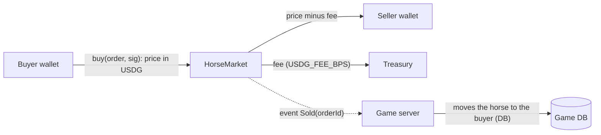

# USDG horse marketplace and auctions (beta, testnet first)

**Owner decision (2026-10-29):** horses can be bought, sold and auctioned for **USDG** (Paxos's
dollar stablecoin on Robinhood Chain; there is no native USDC there, see `docs/web3.md`).
Competitive play and race prizes stay in Stable Credits; the $1,000 giveaway is not part of
this. **Testnet first** while the owner gauges the first users; switching to mainnet is
configuration plus the legal and identity gates below.

This reverses the earlier rule "nothing bought with money can be turned back into money" for
horses that are **registered** for the dollar market. Stable Credits themselves stay closed:
never bought, sold, bridged or transferred for money.

## Who can sell for USDG

A horse joins the USDG market only once it is **registered**:

- owned by the seller's stable, racing age, at least `USDG_MIN_STARTS` Live starts (default 5),
  not on the Legacy Farm, not entered in a race or listed for credits;
- not a starter, gift foal or Club-bred horse (bound horses are never tradeable), and not a
  Premium-pack pull itself (its foals can be);
- the seller has a verified account (18+ ToS) and a linked wallet (SIWE, one wallet per
  account);
- the seller pays a **registration fee** in USDG (default 2 USDG), a sink that makes farming
  horses with free credits to cash out unprofitable.

A registered horse trades **only for USDG** from then on (no credits/USDG arbitrage). Unregistered
horses keep the credits auction house.

## Money flow: no custody, one direction per sale

- **Horses are not NFTs.** They live in the game database; the chain carries the payment and a
  public receipt. The server moves ownership only after verifying the `Sold` event (same
  pattern as `PremiumStore` purchases: order row written first, idempotent fulfilment, backstop
  scanner for paid-but-unfulfilled orders).
- **The contract never holds funds.** `buy` pulls USDG from the buyer and pays the seller and
  the treasury in the same transaction. No balances, no withdrawals, no refunds on-chain.
- **Signed orders.** The server signs an EIP-712 `SaleOrder {orderId, horseRef, seller, buyer,
  price, fee, deadline}` only after checking the listing, both accounts, links between them
  (linked accounts can't trade), the resale lock and the price bounds. Single-use `orderId`.

## Auctions without escrow

Holding bidders' money in a contract means refunds and custody, so auctions settle like a
sealed second chance instead:

1. The seller lists with a reserve and an end time (24-72 h).
2. Bids are **off-chain, signed by the bidder's wallet** (EIP-712 `Bid {listingId, amount,
   bidder, nonce}`), checked by the server (wallet linked, not linked to the seller, amount >=
   reserve and > current best + increment). The board shows the best bid live.
3. At the close, the top bidder gets a signed `SaleOrder` at their bid with a **payment window**
   (default 24 h) and calls `buy`.
4. If they don't pay, the order expires, they are barred from USDG bidding for a period, and the
   next bidder is offered the horse at their own bid.

## Contract: `HorseMarket.sol` (packages/contracts)

- AccessControl (admin, signer), Pausable, ReentrancyGuard, EIP712 ("PostTimeHorseMarket", "1").
- `buy(SaleOrder order, bytes sig)`: checks signer, `msg.sender == order.buyer`, deadline,
  unused `orderId`, `fee <= price`, `fee` matches `feeBps` within rounding; then
  `safeTransferFrom(buyer, seller, price - fee)` and `safeTransferFrom(buyer, treasury, fee)`;
  emits `Sold(orderId, horseRef, seller, buyer, price, fee)`.
- `register(RegistrationOrder order, bytes sig)`: pays the registration fee to the treasury and
  emits `Registered(orderId, horseRef, owner)`. (Or reuse `PremiumStore.purchase` with a
  `horse_registration` SKU: choose whichever keeps one fulfilment path.)
- Token allow-list: USDG only (6 decimals), exact-amount checks (fee-on-transfer safety).
- Admin: set fee bps (cap 10 %), treasury, pause. No function moves funds out of the contract
  because it never holds any.
- Tests: signature, replay, deadline, wrong buyer, pause, fee math, exact amounts; the
  byte-compatible TypeScript adapter (`packages/contracts/adapter`) for hashing orders.

## Server and database (packages/db, apps/web)

- Tables: `usdg_registrations`, `usdg_listings` (fixed price or auction, reserve, ends at,
  status), `usdg_bids`, `usdg_orders` (pending / paid / fulfilled / expired, tx hash).
- Services: register (quote + fulfil), list / delist, bid, close auction (offer to top bidder,
  then next), quote a sale order, fulfil on `Sold`, backstop scan, expire stale orders.
- Rules reused from the credits market: resale lock, listing time limit, horse locks (a listed
  horse can't race or breed), linked-account refusal, verified seller.
- Price bounds: a floor of `USDG_MIN_PRICE` (e.g. 1 USDG) and no ceiling (dollar prices are
  set by players), but the server flags sales far from recent comparable prices for review
  (wash-trading signal).

## UI

- Sales: a **USDG** tab beside the credits auction house: registered lots, fixed price or live
  auction board, the dollar price with the token amount, fee and what the seller receives.
- Horse page: "Register for the USDG market" (requirements checklist, fee), then list or
  auction.
- Wallet connect and network switch (existing SIWE flow); testnet faucet link on testnet.

## Gates before mainnet (not needed for testnet)

- [ ] Identity check (KYC) for sellers above a threshold, sanctions screening at checkout.
- [ ] Legal opinion for the launch markets (selling game items for money; consumer law;
      tax/VAT; money transmission is avoided by never holding funds, confirm with counsel).
- [ ] Decide whether Premium-pack horses' foals may register (they can by default).
- [ ] Economy check with the season harness: registration fee vs farming profit per alt.

## Knobs (to add to docs/foundation/KNOBS.md when built)

`USDG_MIN_STARTS` 5 · registration fee 2 USDG · `USDG_FEE_BPS` 500 (5 %) · auction 24-72 h ·
payment window 24 h · non-payment bar 7 days · `USDG_MIN_PRICE` 1 USDG.
